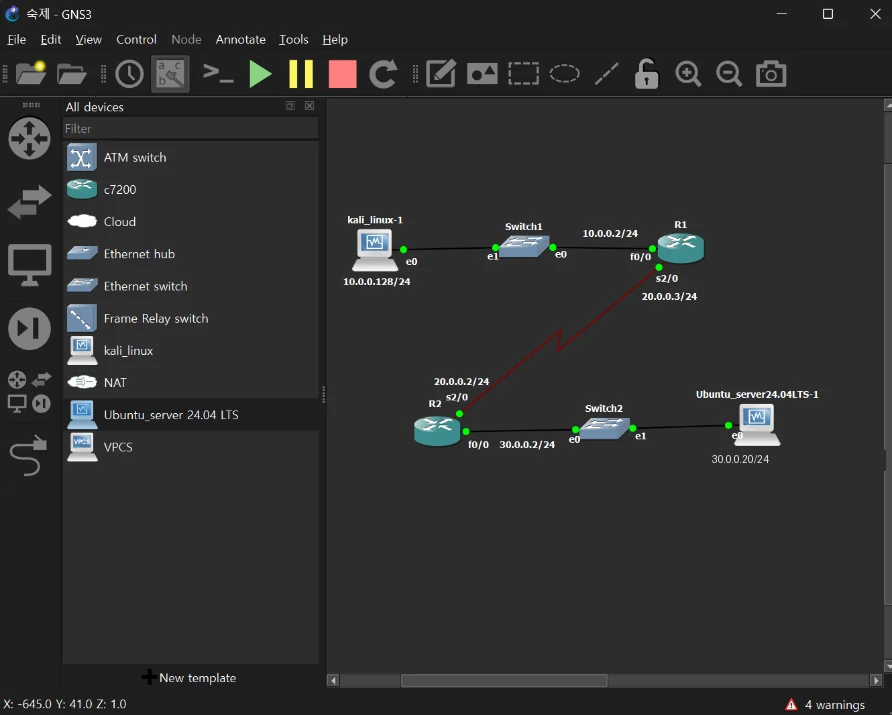
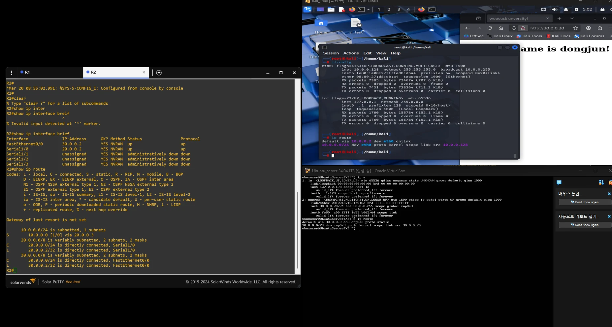
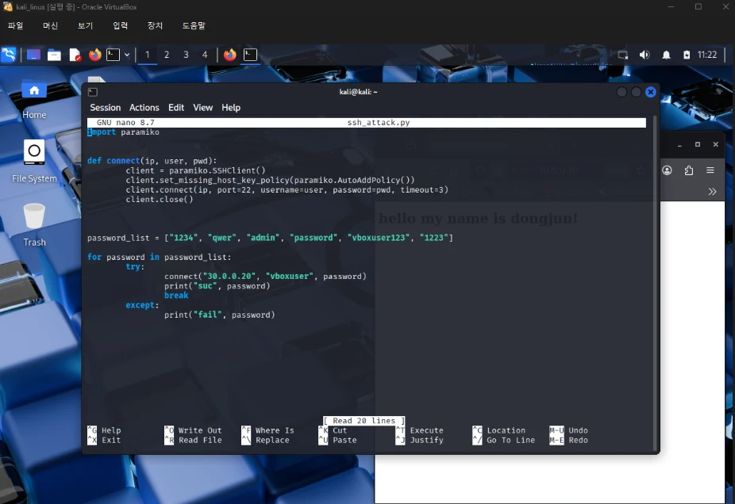
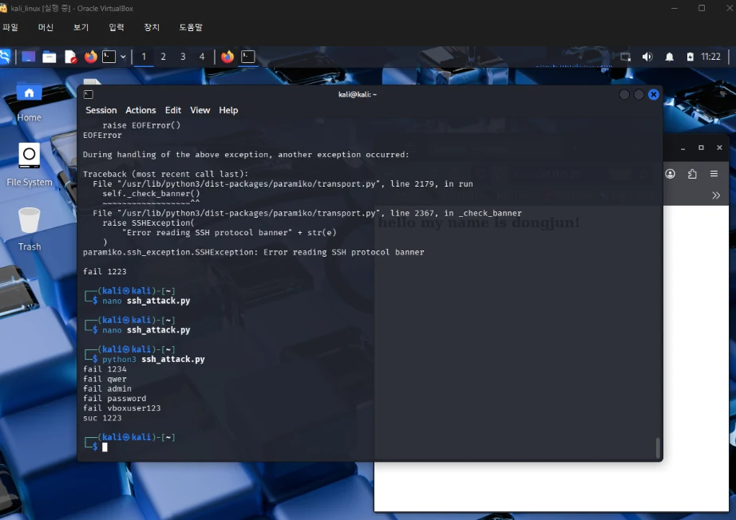
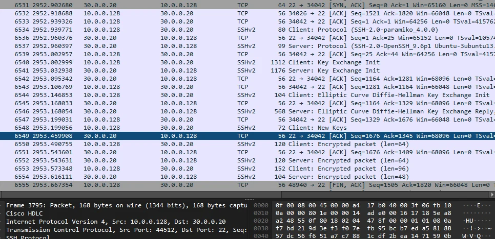
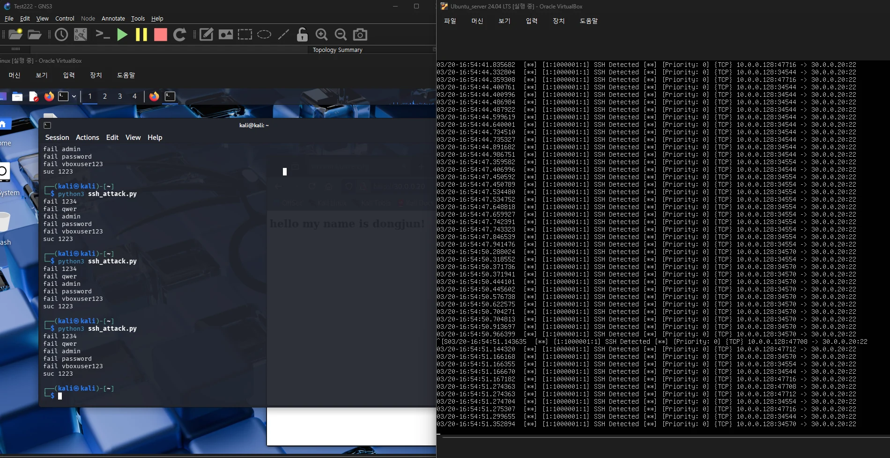
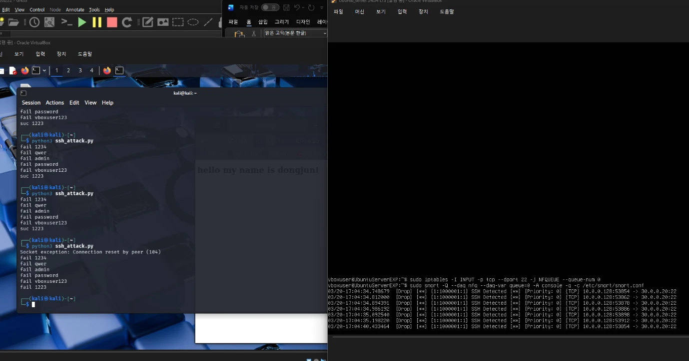

## 들어가며

방화벽은 IP, 포트, 프로토콜 같은 헤더 정보를 기준으로 트래픽을 허용하거나 차단한다. 그런데 허용된 포트(예: 22번 SSH)로 들어오는 <strong>공격성 트래픽</strong>은 방화벽 입장에서 정상 트래픽과 구분되지 않는다. 이 빈틈을 채우는 것이 <strong>IDS(Intrusion Detection System)</strong>와 <strong>IPS(Intrusion Prevention System)</strong>이다.

이 글은 두 부분으로 나뉜다.

1. **개념**: Cisco 공식 문서를 기준으로 IDS/IPS의 동작 원리, 유형, 탐지 방식, 장단점, 차이점을 정리한다
2. **실습**: GNS3 + VirtualBox로 네트워크를 직접 구성하고, SSH 무차별 대입 공격을 Snort로 **탐지(IDS) → 차단(IPS)** 해 본다

> [!NOTE]
> 개념 파트는 Cisco의 *Implementing Cisco IOS Network Security* 6장과 *Cisco Secure Firewall Management Center Device Configuration Guide 7.2*의 "Intrusion Prevention Overview"를 기준으로 정리했다. 자세한 출처는 맨 아래 참고자료에 있다.

---

## 1. IDS와 IPS란?

Cisco 가이드는 두 개념을 다음과 같이 구분한다.

- **침입 탐지(IDS)**: 트래픽을 **수동적으로(passive)** 모니터링·분석해 침입 징후를 찾고, 나중에 분석할 수 있도록 공격 데이터를 기록한다.
- **침입 방지(IPS)**: 탐지 기능을 포함하면서, 네트워크를 지나가는 악성 트래픽을 **차단하거나 변조**할 수 있다.

즉 IPS는 IDS 위에 "대응"을 얹은 구조이고, 그래서 둘을 묶어 IDPS(Intrusion Detection and Prevention System)라고 부르기도 한다.

### 1-1. 배치 방식: Promiscuous vs Inline

둘의 결정적인 차이는 **트래픽 경로 위에 있느냐**이다.

| 구분 | IDS (Promiscuous 모드) | IPS (Inline 모드) |
|---|---|---|
| 받는 트래픽 | 스위치가 복사해 준 **사본** (SPAN/TAP) | 실제 트래픽이 센서를 **통과** |
| 원본 트래픽 | 센서와 상관없이 목적지로 전달 | 센서가 "깨끗하다"고 판단해야 전달 |
| 대응 시점 | 악성 트래픽이 이미 지나간 **뒤** | 목적지에 도달하기 **전** |
| 차단 방법 | 라우터·방화벽에 차단 요청, 관리자 알림 | 센서가 직접 패킷 drop / 연결 reset |

```text
[IDS]  공격자 ──▶ 스위치 ──▶ 서버          [IPS]  공격자 ──▶ IPS 센서 ──▶ 서버
                   │ (복사본)                                   │
                   ▼                                         검사 후 통과/차단
                 IDS 센서 ──▶ 알림
```

Cisco 문서는 IDS의 동작을 "스위치가 패킷을 센서로 복사 → 시그니처 매칭 → 스위치에 차단 요청 + 관리 콘솔에 알림"으로 설명하면서, **이 사이에 대상이 이미 공격받을 수 있다**고 짚는다. 반면 IPS는 패킷이 도착하는 즉시 분석하고 위반 트래픽을 그 자리에서 버린다.

### 1-2. 내부 동작 흐름

Cisco Secure Firewall(내부 엔진이 Snort)의 처리 과정을 보면 IDS/IPS가 패킷을 어떻게 다루는지 감이 온다.

1. **디코딩**: 패킷을 TCP/IP 하위 3계층까지 해석한다
2. **정규화·전처리**: IP 단편화 재조립, 체크섬 검사, TCP/UDP 세션 추적, 애플리케이션 계층 디코딩을 한다. 포트스캔·SYN Flood 같은 비율 기반 공격도 이 단계에서 잡는다. Inline 정규화는 트래픽 형태를 통일해 **회피 기법을 어렵게** 만든다.
3. **룰 검사**: 활성화된 룰을 묶어서 프로토콜 필드, 콘텐츠, 패킷 이상 여부를 검사한다
4. **이벤트 생성**: 매칭되면 IP/포트/시간/패킷 내용을 담은 이벤트를 남기고, Inline이면 drop·변조까지 수행한다

룰에서 쓰는 `$HOME_NET`, `$EXTERNAL_NET` 같은 변수를 **실제 네트워크에 맞게 조정하라**는 것이 Cisco의 강한 권고다. 이게 안 되어 있으면 오탐이 크게 늘어난다.

---

## 2. 유형

### 2-1. 감시 위치에 따른 분류

| | 네트워크 기반 (NIDS/NIPS) | 호스트 기반 (HIDS/HIPS) |
|---|---|---|
| 위치 | 네트워크 주요 지점의 센서 | 개별 서버·PC에 설치 |
| 보는 것 | 네트워크 전체 트래픽 | 해당 호스트의 로그, 파일, 프로세스, OS 호출 |
| 장점 | OS와 무관, 호스트가 늘어도 센서 추가 불필요, 네트워크상에서 잘 드러나지 않음 | 공격 **성공 여부**를 알 수 있음, 복호화된 뒤의 데이터를 봄, 단편화·TTL 트릭에 영향 없음 |
| 단점 | 암호화 트래픽 안을 보지 못함, 단편화 재조립이 어려움, 공격 성공 여부를 모름, 대역폭이 늘면 센서도 늘어야 함 | OS 종속, 모든 호스트에 설치해야 함, 네트워크 전체 시야가 없음 |

이 외에 무선망을 감시하는 **WIPS**, 트래픽 흐름의 이상을 보는 **NBA(Network Behavior Analysis)** 도 있다.

### 2-2. 탐지 방식에 따른 분류

| 방식 | 동작 | 장점 | 단점 |
|---|---|---|---|
| **시그니처 기반** | 알려진 공격 패턴 DB와 비교 | 설정이 쉽고 오탐이 적음 | **알려지지 않은 공격 탐지 불가**, 시그니처 지속 업데이트·튜닝 필요 |
| **정책 기반** | 보안 정책으로 만든 룰, 통계 임계값(예: 포트 스윕) | 단순하고 신뢰성 높음, 미지의 공격도 탐지 | 결과가 포괄적, 정책을 먼저 만들어야 함 |
| **이상(프로파일) 기반** | "정상" 상태에서 벗어난 행위 탐지 | 미지의 공격 탐지 가능 | 큰 네트워크에서 "정상"을 정의하기 어려움, 학습 기간 중 공격이 있으면 그것을 정상으로 학습 |
| **허니팟 기반** | 미끼 서버로 공격을 유인 | 공격 정보 수집, 공격 지연 | 전용 서버 필요, IDS/IPS를 대체하지 못함 |

### 2-3. 공격 패턴: Atomic vs Composite

- **Atomic**: 패킷 하나로 완성되는 공격이다. IPS는 이 패킷을 그대로 버리면 되지만, IDS는 사본을 볼 뿐이라 막지 못한다.
- **Composite**: 여러 패킷·여러 시점에 걸친 공격이다. **Inline IPS라도 시그니처가 매칭되기 전까지 공격 일부가 이미 통과할 수 있다.** 뒤의 실습에서 실제로 이 현상을 확인한다.

---

## 3. 탐지 결과의 네 가지 경우

| | 실제 침입 O | 실제 침입 X |
|---|---|---|
| **알람 O** | True Positive (정탐) | **False Positive (오탐)** |
| **알람 X** | **False Negative (미탐)** | True Negative |

Cisco 문서가 드는 오탐 예시가 재미있는데, <strong>"정상 관리자가 비밀번호를 잘못 입력한 경우"</strong>이다. 이번 실습의 SSH 무차별 대입 룰이 정확히 이 문제를 안고 있다.

---

## 4. 장단점 비교

| | IDS (Promiscuous) | IPS (Inline) |
|---|---|---|
| **장점** | 지연·지터 없음 / 센서가 죽어도 네트워크는 정상 동작 / 과부하가 나도 분석만 느려지고 트래픽은 영향 없음 | 트리거 패킷 자체를 drop / 스트림 정규화로 회피 기법 상당수 무력화 / 공격이 대상에 닿기 전에 차단 |
| **단점** | 트리거 패킷을 막을 수 없음 / 트래픽 경로 밖에 있어 회피 기법에 더 취약 / 정교한 정책과 튜닝 필요 | 센서 오류·장애가 곧 네트워크 장애 / 과부하 시 네트워크 성능 저하 / 지연·지터 발생(VoIP 등 고려) / **오탐으로 정상 서비스를 끊을 수 있음** |

Cisco는 IPS 운영 시 **drop 액션을 너무 공격적으로 쓰지 말라**고 경고한다. 오탐 하나가 업무 핵심 애플리케이션을 끊어버릴 수 있기 때문이다. 또 단순 drop은 출발지에 아무것도 알리지 않으므로, reset + 알림과 함께 쓰는 것을 권장한다.

> [!TIP]
> **한 줄 요약**: IDS는 "봤다고 알려주는" 장비, IPS는 "보고 바로 막는" 장비다. 그 대가로 IPS는 지연과 오탐 차단이라는 위험을 떠안는다.

---

## 5. 실습: GNS3 + VirtualBox + Snort

### 5-1. 실습 환경

GNS3 안에 VirtualBox VM(Kali, Ubuntu Server)과 Cisco c7200 라우터 2대를 연결하고, 정적 라우팅으로 서로 다른 대역을 통신시켰다.

| 노드 | 역할 | 주소 |
|---|---|---|
| Kali Linux | 공격자 | 10.0.0.128/24 (GW 10.0.0.2) |
| R1 (c7200) | 라우터 | f0/0 10.0.0.2 / s1/0 20.0.0.3 |
| R2 (c7200) | 라우터 | f0/0 30.0.0.2 / s1/0 20.0.0.2 |
| Ubuntu Server 24.04 | 피해 서버 + Snort | 30.0.0.20/24 (GW 30.0.0.2) |


_GNS3 토폴로지. 화면상 시리얼 포트는 s2/0이지만 오류가 나서 s1/0으로 바꿔 사용했다_

라우터 핵심 설정은 양쪽에 반대편 대역으로 가는 정적 경로를 넣는 것이다.

```text
! R1
interface s1/0
 ip address 20.0.0.3 255.255.255.0
 no shutdown
ip route 30.0.0.0 255.255.255.0 20.0.0.2

! R2
interface s1/0
 ip address 20.0.0.2 255.255.255.0
 no shutdown
ip route 10.0.0.0 255.255.255.0 20.0.0.3
```


_R2 라우팅 테이블(S 10.0.0.0 via 20.0.0.3)과 Kali·Ubuntu의 게이트웨이 설정 확인_

> [!WARNING]
> **트러블슈팅 메모**: 처음에는 시리얼 인터페이스가 `shutdown` 상태라 라우팅 테이블에 경로가 안 올라왔다. VM을 재부팅한 뒤 임시로 넣은 IP가 날아가 `No route to host`가 나기도 했는데, Kali는 `/etc/network/interfaces`에 고정 IP를 넣어 해결했다.

### 5-2. 공격 시나리오: SSH 무차별 대입

탐지할 "악성 트래픽"을 만들기 위해, Kali에서 Ubuntu의 `vboxuser` 계정에 **미리 정한 비밀번호 몇 개를 순서대로 대입**하는 간단한 스크립트를 돌렸다. 사전 파일을 자동으로 돌리는 실제 무차별 대입이 아니라, "짧은 시간에 같은 출발지에서 SSH 인증이 반복되면 어떤 트래픽 패턴이 생기는지"를 보여주는 게 목적이다.

- 라이브러리: Python `paramiko` (SSH 클라이언트)
- 대상: `30.0.0.20:22`, 계정 `vboxuser`
- 동작: 비밀번호 리스트를 순회하며 접속을 시도하고, 실패하면 `fail`, 성공하면 `suc`를 출력한 뒤 멈춘다


_paramiko 기반 SSH 접속 반복 스크립트_


_여러 비밀번호가 fail로 찍히다가 올바른 값에서 suc가 출력된다_

Wireshark로 보면 한 번의 SSH 시도마다 TCP 3-way handshake → `SSH-2.0` 배너 교환 → 키 교환(Key Exchange) → 암호화된 패킷 순으로 진행된다. 공격 중에는 이 과정이 **같은 출발지(10.0.0.128)에서 22번 포트로 아주 짧은 간격에 수십 번** 반복된다. 정상 로그인이 보통 몇 초에 한두 번인 것과 뚜렷이 대비되고, 이 "짧은 시간 내 반복"이 바로 탐지 포인트가 된다.


_SSHv2 연결 과정. 페이로드는 암호화되어 내용이 보이지 않는다(네트워크 IDS의 한계와도 연결되는 지점)_

암호화 때문에 내용은 안 보이지만, **출발지/포트/빈도** 같은 메타데이터만으로도 무차별 대입은 충분히 탐지할 수 있다. 그게 바로 다음 단계다.

### 5-3. IDS 실습: Snort로 탐지 (alert)

피해 서버(Ubuntu)에 Snort를 설치하고, "같은 출발지가 30초 안에 SSH 접속을 3번 이상 시도하면 경고"하는 룰을 작성했다.

```text
# /etc/snort/rules/local.rules
alert tcp any any -> any 22 ( \
  msg:"SSH Detected"; \
  flow:to_server; flags:S; \
  detection_filter:track by_src, count 3, seconds 30; \
  sid:1000001; rev:1; )
```

- `flow:to_server; flags:S;`: 서버로 향하는 **SYN 패킷만** 세어서, 연결 하나가 여러 번 카운트되는 것을 막는다
- `detection_filter:track by_src, count 3, seconds 30`: 출발지 기준 30초 안에 3회 이상일 때만 발동한다

이 상태로 공격을 다시 돌리면 Snort 콘솔에 경고가 쏟아진다. **하지만 공격 자체는 그대로 성공한다.** 이게 IDS의 본질이다. 알리기만 하고 막지는 않는다.


_"SSH Detected" 경고 로그. 출발지 10.0.0.128 → 30.0.0.20:22가 반복 기록된다_

### 5-4. IPS 실습: Snort로 차단 (drop + NFQUEUE)

같은 구성에서 두 가지만 바꾸면 IPS가 된다.

1. **룰의 액션을 `alert` → `drop`으로 변경**
2. **iptables로 패킷을 Snort에 먼저 넘기기** (NFQUEUE)

```bash
# 들어오는 22번 트래픽을 커널이 서버로 넘기기 전에 Snort 큐로 보냄
sudo iptables -I INPUT -p tcp --dport 22 -j NFQUEUE --queue-num 0

# Snort를 inline(NFQUEUE) 모드로 실행
sudo snort -Q --daq nfq --daq-var queue=0 -A console -q -c /etc/snort/snort.conf
```

이제 같은 공격을 실행하면 로그의 액션이 `[Drop]`으로 바뀌고, **공격 패킷이 실제로 차단**된다. 공격자 쪽 터미널에는 `Connection reset by peer`가 뜨고, 이전에는 성공하던 마지막 비밀번호까지 전부 `fail`로 끝난다.


_액션이 [Drop]으로 바뀌며 SSH 시도가 차단되는 모습_

| | IDS 구성 | IPS 구성 |
|---|---|---|
| 룰 액션 | `alert` | `drop` |
| 패킷 경로 | 복사본만 검사 | iptables NFQUEUE로 **인라인 검사** |
| 공격 결과 | 성공(로그만 남음) | 차단(연결 reset) |

> [!WARNING]
> **구성상 주의**: 이번 실습은 Snort를 피해 서버 **안**에 설치하고 `INPUT` 체인에 걸었으므로, 엄밀히는 **호스트 기반 IPS(HIPS)** 에 가깝다. 실무의 네트워크 인라인 IPS는 R2와 서버 사이에 별도 센서를 두고 트래픽이 센서를 물리적으로 통과하게 구성한다. 앞의 개념 파트에서 본 NIPS/HIPS 구분이 여기서 그대로 드러난다.

### 5-5. 생각해 볼 실험: 오탐과 미탐

개념 파트의 False Positive / False Negative를 이 룰에 대입해 보면 IDS/IPS의 한계가 와닿는다.

- **오탐(False Positive)**: 정상 사용자가 30초 안에 비밀번호를 3번 틀리면 똑같이 탐지된다. Cisco 문서가 든 "관리자가 비밀번호를 잘못 친 경우"가 그대로 재현되는 것이다. IPS였다면 정상 사용자가 차단됐을 것이다.
- **미탐(False Negative)**: 시도 사이에 11초씩 지연을 넣어 **30초에 3회 미만**으로 늦추면 룰을 피해 간다. 개념 파트에서 본 지연 공격을 통한 우회이자 Composite 공격의 탐지 한계다.

결국 "룰을 어떻게 튜닝하느냐가 전부"라는 결론으로 이어진다. `count`와 `seconds`를 조이면 미탐은 줄지만 오탐이 늘고, 풀면 그 반대가 된다.

---

## 6. 마무리

- **방화벽**이 "누가 들어오는가(헤더)"를 본다면, **IDS/IPS**는 "무엇을 하려는가(패턴·행위)"를 본다.
- **IDS = 탐지·알림**, **IPS = 탐지·차단**이다. IPS는 강력한 대신 지연·오탐 차단이라는 비용을 진다.
- 실습에서 룰 하나를 `alert`에서 `drop`으로 바꾸고 NFQUEUE를 더한 것만으로 IDS가 IPS가 되었다. 둘은 별개 장비가 아니라 **같은 엔진의 배치·대응 차이**라는 걸 직접 확인한 셈이다.
- 지금은 Snort/Suricata 같은 엔진이 NGFW·XDR에 통합되고, 시그니처 기반을 넘어 ML 기반 이상 탐지로 확장되는 흐름이다.

---

## 참고자료

- Cisco, *Implementing Cisco IOS Network Security*, Ch.6 "Network Security Using Cisco IOS IPS"
- Cisco, *Secure Firewall Management Center Device Configuration Guide 7.2*, "Intrusion Prevention Overview"
- [Snort 공식 문서](https://www.snort.org/documents)
- NIST SP 800-94, *Guide to Intrusion Detection and Prevention Systems (IDPS)*
