## 이 글의 목적

Yahboom 공식 자료 25개 과정 폴더 중 **우리 구성에 해당하는 건 절반 정도**다. 이 글은 무엇을 따라 하고 무엇을 건너뛸지, 그리고 그걸 이해하는 데 필요한 ROS2·DDS·rviz 기초를 한 곳에 정리한 0탄이다. 순서는 0탄이지만 [2탄](/public/posts/blog-docs/rosmaster-m1-part2-ros2-lidar-slam/)에서 겪은 시행착오를 바탕으로 썼다.

| 항목 | 우리 구성 | 자료 고를 때 주의 |
| --- | --- | --- |
| 메인 보드 | 라즈베리파이5 (Docker 안 ROS2 Humble) | Jetson / RDK X5 / Orin 전용 자료는 건너뛴다 |
| 라이다 | YDLIDAR Tmini Plus (`/dev/rplidar`) | 컨테이너 설정값 `my_lidar: tmini` |
| 카메라 | USB 카메라 (PTZ 위) | **깊이(Depth) 카메라 자료는 해당 없음** |
| 음성 | 음성 모듈 (USB) | AI 음성 자료는 API 키·모델 필요 |
| 제어 보드 | STM32 확장보드 V3.0 (`/dev/myserial`) | STM32 펌웨어 개발은 선택 |
| 시각화 | 노트북 VirtualBox Ubuntu 22.04 + ROS2 Humble | rviz는 노트북에서 |

공식 자료: [YahboomTechnology/ROSMASTER-M1](https://github.com/YahboomTechnology/ROSMASTER-M1)

## Yahboom PDF 로드맵: 무엇을 어떤 순서로

핵심 경로는 <strong>01 → 21(ROS2 기초) → 06(차체) → 11(라이다) → 09(카메라) → 14(YOLO)</strong>다. 시리즈의 2탄~3탄이 이 순서를 그대로 따른다. 폴더 번호는 GitHub 저장소 기준이다.

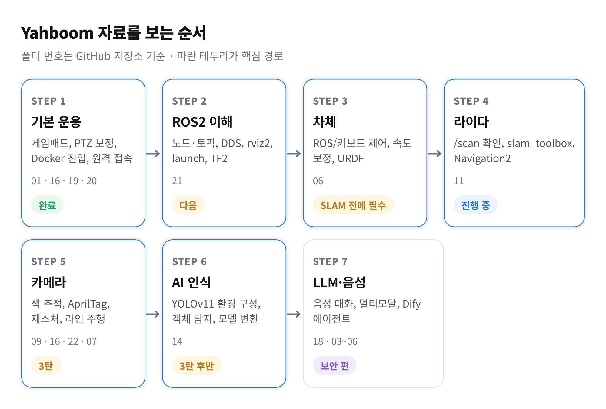
_전체 순서를 한 장으로 요약한 그림. 자세한 문서 번호와 링크는 아래 표에 있다_

| 단계 | 폴더 / 문서 (링크) | 왜 보나 | 상태 |
| --- | --- | --- | --- |
| 1. 기본 운용 | [01 Robot Configuration](https://github.com/YahboomTechnology/ROSMASTER-M1/tree/main/01.Robot%20Configuration%20and%20Operation%20Guide) — 1~4 전부 | 게임패드 조작, PTZ 보정, Docker 진입 | 완료 |
| 1. 기본 운용 | [16 Main Control Board / Raspberry Pi](https://github.com/YahboomTechnology/ROSMASTER-M1/tree/main/16.Main%20Control%20Board%20Course/Raspberry%20Pi) — 2, 4, 6, 8, 9, 16 | 시스템 백업, 부팅, raspi-config, 네트워크, 원격 접속, 온도 | 완료 (백업만 남음) |
| 1. 기본 운용 | [19 Linux](https://github.com/YahboomTechnology/ROSMASTER-M1/tree/main/19.Linux%20System%20Course) — 12 Bind device ID, 13 Capacity expansion | udev 장치 바인딩, SD 용량 확장 | 12 완료, 13 할 것 |
| 1. 기본 운용 | [20 Docker](https://github.com/YahboomTechnology/ROSMASTER-M1/tree/main/20.Docker%20Course) — 2, 3, 4 | 컨테이너 명령, 다중 터미널, 시작 스크립트 | 복습 |
| 2. ROS2 이해 | [21 ROS2 basic](https://github.com/YahboomTechnology/ROSMASTER-M1/tree/main/21.ROS2%20basic%20course) — 1, 6, 7, 8, 9 | 노드·토픽·서비스·액션 개념 | 다음 |
| 2. ROS2 이해 | [21 ROS2 basic](https://github.com/YahboomTechnology/ROSMASTER-M1/tree/main/21.ROS2%20basic%20course) — 13, 14, 16, 17, 19, 23 | 분산 통신, DDS, 명령어, rviz2, launch, TF2 (아래 섹션에 요약) | 다음 |
| 2. ROS2 이해 | [21 ROS2 basic](https://github.com/YahboomTechnology/ROSMASTER-M1/tree/main/21.ROS2%20basic%20course) — 3, 4, 5, 10, 11 | 워크스페이스·패키지·커스텀 메시지. 직접 노드를 짤 때 | 코딩 시작 때 |
| 3. 차체 | [06 Chassis Control](https://github.com/YahboomTechnology/ROSMASTER-M1/tree/main/06.Chassis%20Control%20Course) — 1~6 | ROS/키보드 제어, **4·5 속도 보정**, URDF | SLAM 전에 필수 |
| 4. 라이다 | [11 LiDAR](https://github.com/YahboomTechnology/ROSMASTER-M1/tree/main/11.LiDAR%20Course) — 1 기본 사용 | `/scan` 확인 | 완료 |
| 4. 라이다 | [11 LiDAR](https://github.com/YahboomTechnology/ROSMASTER-M1/tree/main/11.LiDAR%20Course) — 2, 3, 4 | 장애물 회피·추종·순찰. 지도 없는 가장 쉬운 자율 동작 | 3탄 초반 |
| 4. 라이다 | [11 LiDAR](https://github.com/YahboomTechnology/ROSMASTER-M1/tree/main/11.LiDAR%20Course) — 7 slam_toolbox | 지도 작성·저장 | 진행 중 |
| 4. 라이다 | [11 LiDAR](https://github.com/YahboomTechnology/ROSMASTER-M1/tree/main/11.LiDAR%20Course) — 8, 9 Navigation2 | 단일/다중 목표 자율주행 | 3탄 목표 |
| 4. 라이다 | [11 LiDAR](https://github.com/YahboomTechnology/ROSMASTER-M1/tree/main/11.LiDAR%20Course) — 5 Gmapping, 6·10 Cartographer, 13 APP | 다른 SLAM 비교용 | 선택 |
| 5. 카메라 | [16 Raspberry Pi](https://github.com/YahboomTechnology/ROSMASTER-M1/tree/main/16.Main%20Control%20Board%20Course/Raspberry%20Pi) — 14 Using USB camera | 카메라 장치 점검 | 다음 (카메라 문제) |
| 5. 카메라 | [09 USB Camera Vision](https://github.com/YahboomTechnology/ROSMASTER-M1/tree/main/09.USB%20Camera%20Vision%20Course) — 01, 03, 06, 08, 14 | 색 추적, AprilTag, 제스처, 추종, 비전 라인 주행 | 3탄 |
| 5. 카메라 | [22 Image Processing](https://github.com/YahboomTechnology/ROSMASTER-M1/tree/main/22.Image%20Processing%20Basics%20Course), [07 Mediapipe](https://github.com/YahboomTechnology/ROSMASTER-M1/tree/main/07.Mediapipe%20Visual%20Course) | OpenCV·Mediapipe 배경 지식 | 필요할 때 |
| 6. AI 인식 | [14 YOLOv11 (Raspberry Pi & Jetson Nano)](https://github.com/YahboomTechnology/ROSMASTER-M1/tree/main/14.YOLOv11%20Development%20%28Raspberry%20Pi%20%26%20Jetson%20Nano%29) — 1, 2, 3, 8, 9 | 환경 구성, 객체 탐지, 모델 변환 | 3탄 후반 |
| 7. LLM·음성 | [18 AI Large Model (…Raspberry Pi)](https://github.com/YahboomTechnology/ROSMASTER-M1/tree/main/18.AI%20Large%20Model%20Basic%20Course%28Jetson%20Orin%26RDK%20X5%26Raspberry%20Pi%29), [03 AI Model Basics](https://github.com/YahboomTechnology/ROSMASTER-M1/tree/main/03.AI%20Model%20Basics)~06 | 음성 대화, 멀티모달, Dify 에이전트 | 보안 편 (프롬프트 인젝션) |
| 이론 | [23 STM32](https://github.com/YahboomTechnology/ROSMASTER-M1/tree/main/23.Control%20Board%20STM32%20Driver%20Course) — 14 메카넘 기구학, 15 PID | 모터가 왜 그렇게 움직이는지 | 읽기만 |
| 보안 준비 | [24 Main Control Communication](https://github.com/YahboomTechnology/ROSMASTER-M1/tree/main/24.Control%20Board%20Main%20Control%20Communication%20Course) — 2 Rosmaster driver library | 파이 ↔ STM32 시리얼 프로토콜. 4탄에서 분석 대상 | 보안 편 |

**건너뛸 것:** 10 Depth Camera (깊이 카메라 없음), 13 YOLO (ORIN), 15 YOLO (RDKX5), 17 AI (Jetson Nano), 16의 Jetson·RDK X5 하위 폴더, 08의 6·7 (ORIN), 12 Multi-vehicle (로봇 1대), 25 Autonomous Driving (트랙 맵 별도 구매), 11의 RTAB-Map(11·12)은 깊이 카메라 전제라 보류.

> [!WARNING]
> 01의 Docker 진입 자료처럼 Jetson과 라즈베리파이를 한 문서에서 다루는 경우가 많다. 명령어의 이미지 이름, 스크립트 경로는 항상 Raspberry Pi 5 쪽 것을 쓴다.

## 먼저 공부할 기초

PDF를 따라 치다 막히는 지점은 대부분 ROS2가 아니라 그 아래 층(리눅스·USB·네트워크)이었다. [2탄의 시행착오](/public/posts/blog-docs/rosmaster-m1-part2-ros2-lidar-slam/#시행착오-요약) 12개 중 8개가 그랬다.

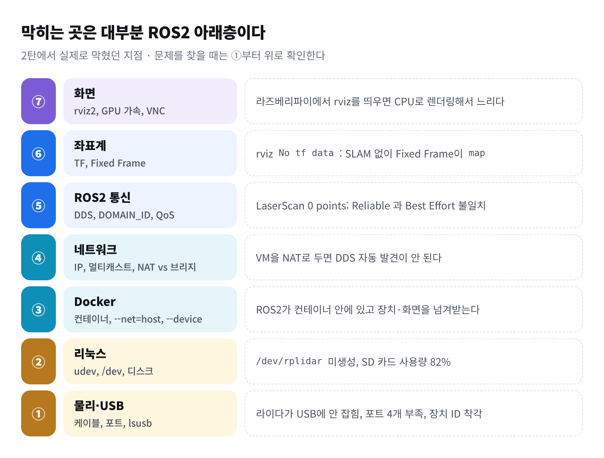
_2탄에서 막혔던 지점을 층별로 나눈 그림. 아래 표는 각 층에서 알아야 할 것을 정리한 것이다_

| 분야 | 알아야 할 것 | 왜 필요했나 (실제 사례) |
| --- | --- | --- |
| 리눅스 장치 | `lsusb`, `/dev/ttyUSB*`, `/dev/video*`, udev 규칙, 심볼릭 링크 | `/dev/rplidar` 미생성, 장치 ID 착각 |
| 리눅스 디스크 | `df -h`, `lsblk`, 파티션 확장 | SD 카드 사용량 82% (rootfs가 카드 전체로 확장 안 됨) |
| Docker | 이미지 vs 컨테이너, `docker ps`/`exec`, 볼륨, `--net=host`, `--device`, `DISPLAY` | ROS2가 컨테이너 안에 있고 장치·화면을 넘겨받는다 |
| 네트워크 | IP, 서브넷, 멀티캐스트, NAT vs 브리지, UDP | VM을 NAT로 두면 DDS 자동 발견이 안 된다 |
| 그래픽 | GPU 가속 vs CPU 렌더링, X11/Wayland, VNC | Pi에서 rviz 렉 |
| ROS2 개념 | 노드, 토픽, 메시지 타입, launch, 파라미터 | 모든 PDF의 전제 |
| ROS2 통신 | DDS, DOMAIN_ID, QoS | 노트북 연동, LaserScan 0 points |
| 좌표계 | TF, frame (map / odom / base_link / laser_frame) | rviz `No tf data` |
| 로봇 이론 | 메카넘 역기구학, 오도메트리, PID, SLAM 원리 | 3탄 자율주행 품질 |

> [!TIP]
> 추천 외부 자료: [ROS 2 Humble 공식 튜토리얼](https://docs.ros.org/en/humble/Tutorials.html)의 Beginner: CLI tools 파트가 21번 폴더와 거의 같은 내용을 더 정확하게 다룬다.

## ROS2와 DDS 이론

ROS2의 통신은 전부 DDS(Data Distribution Service) 위에서 돌아간다. 중앙 서버 없이 같은 네트워크·같은 DOMAIN_ID의 노드끼리 서로를 찾아 직접 데이터를 주고받는다. 노트북 VM이 아무 설정 없이 로봇의 `/scan`을 받을 수 있었던 이유다.

### 계층 구조

| 계층 | 무엇 | 우리 환경 |
| --- | --- | --- |
| 애플리케이션 | 내가 짠 노드 (Python rclpy / C++ rclcpp) | `Mcnamu_driver_M1`, `ydlidar_ros2_driver_node` |
| rcl / rmw | ROS 공통 로직 + DDS 교체용 인터페이스 | `RMW_IMPLEMENTATION` 환경변수로 선택 |
| DDS 구현체 | Fast DDS(Humble 기본), Cyclone DDS 등 | 양쪽이 같은 구현체일 때 가장 안정적 |
| RTPS | DDS가 쓰는 실제 와이어 프로토콜 | Wireshark에서 `rtps` 필터로 보인다 |
| UDP/IP | 멀티캐스트(발견) + 유니캐스트(데이터) | WiFi 공유기 |

### 통신 방식 4가지

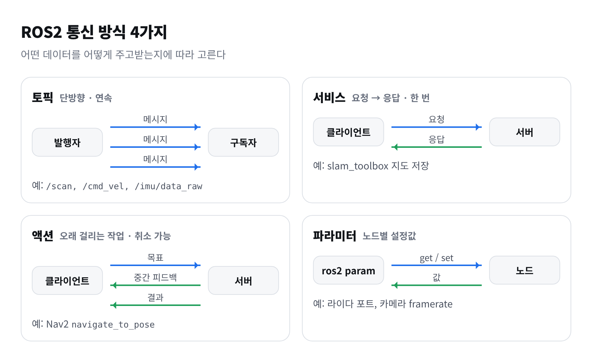
_토픽은 계속 흘러가는 데이터, 서비스와 액션은 요청에 대한 응답이다_

| 방식 | 형태 | 우리 로봇 예 |
| --- | --- | --- |
| 토픽 (Topic) | 발행자 → 구독자, 단방향 연속 데이터 | `/scan`, `/cmd_vel`, `/imu/data_raw` |
| 서비스 (Service) | 요청 → 응답, 한 번 | slam_toolbox 지도 저장 |
| 액션 (Action) | 목표 → 중간 피드백 → 결과, 취소 가능 | Nav2 `navigate_to_pose` |
| 파라미터 (Parameter) | 노드별 설정값 | 라이다 포트, 카메라 framerate |

### 디스커버리와 DOMAIN_ID

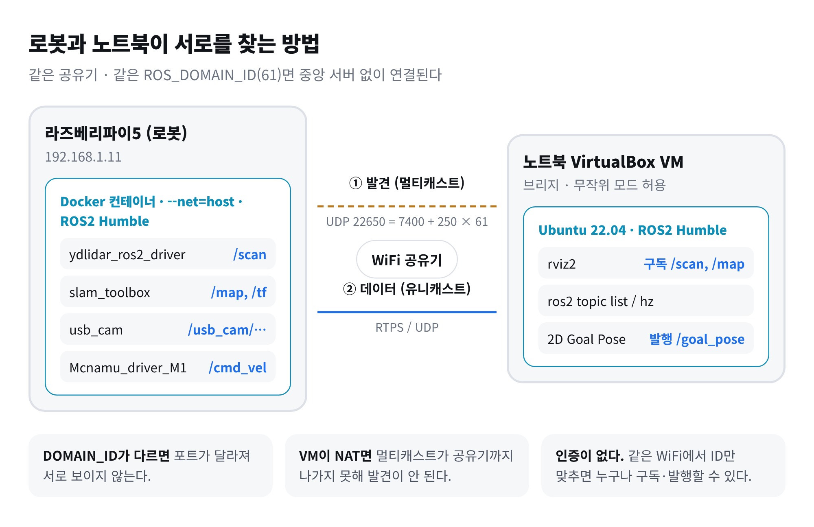
_먼저 멀티캐스트로 서로를 찾고(①), 그다음 노드끼리 직접 데이터를 주고받는다(②)_

- 노드가 켜지면 멀티캐스트로 "나 여기 있고 이 토픽을 발행한다"를 알린다. 토픽 이름·타입·QoS가 맞는 상대끼리 연결된다.
- DOMAIN_ID는 사용할 UDP 포트 번호를 갈라놓는 값이다. 발견용 멀티캐스트 포트 = 7400 + 250 × DOMAIN_ID. 우리는 61이라 **22650번**이다.
- 값이 다르면 서로 안 보인다. 리눅스에서는 0~101 사이를 쓰는 게 안전하다.
- `ROS_LOCALHOST_ONLY=1`이면 같은 컴퓨터 안에서만 통신한다.
- Docker는 `--net=host`로 돌아서 컨테이너가 라즈베리파이의 네트워크를 그대로 쓴다. 그래서 컨테이너 안 노드가 노트북에서 바로 보인다.

### QoS (통신 품질 정책)

| 정책 | 선택지 | 의미 |
| --- | --- | --- |
| Reliability | Reliable / Best Effort | 재전송해서라도 다 보낼지, 놓친 건 버릴지 |
| Durability | Volatile / Transient Local | 늦게 들어온 구독자에게 마지막 값을 다시 줄지 |
| History / Depth | Keep Last N / Keep All | 버퍼에 몇 개를 쌓아둘지 |
| Deadline, Liveliness | 주기 | 데이터가 제때 오는지, 발행자가 살아 있는지 |

호환 규칙은 하나만 기억하면 된다. **구독자가 발행자보다 더 까다로운 걸 요구하면 연결되지 않는다.**

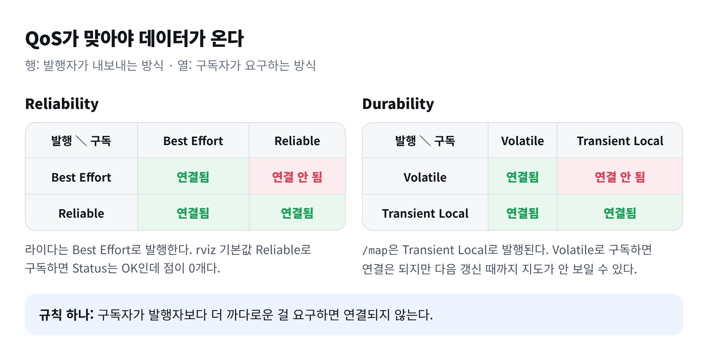
_빨간 칸이 연결되지 않는 조합이다_

- 센서(라이다·카메라)는 보통 Best Effort로 발행한다. rviz가 Reliable로 구독하면 데이터가 안 온다 → 2탄의 `Showing [0] points`
- `/map`은 Transient Local로 발행된다. rviz Map을 Volatile로 두면 다음 갱신 때까지 지도가 안 보일 수 있다
- 현재 QoS는 `ros2 topic info -v /scan`으로 양쪽 모두 확인할 수 있다

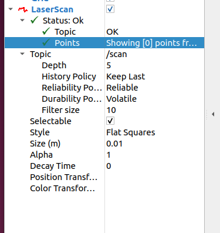
_실제로 겪은 화면. Reliability Policy가 `Reliable`이라 Status는 OK인데 점이 0개다 (2탄)_

### TF (좌표계)

로봇에는 좌표계가 여러 개 있고, TF가 그들 사이의 위치 관계를 실시간으로 관리한다. 자율주행 로봇의 표준 사슬은 다음과 같다.

```text
map ──(SLAM/AMCL이 발행)──▶ odom ──(오도메트리)──▶ base_link ──(고정, URDF)──▶ laser_frame / camera_link
```

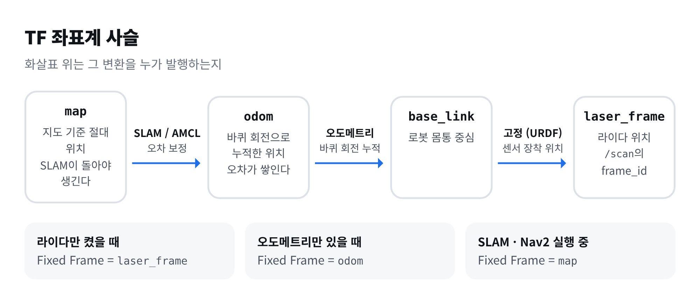
_같은 사슬을 그림으로 나타낸 것. 아래 칸은 상황별 Fixed Frame이다_

- `map`: 지도 기준 절대 위치. SLAM이 돌아야 생긴다
- `odom`: 바퀴 회전으로 누적한 위치. 부드럽지만 시간이 지날수록 오차가 쌓인다
- `base_link`: 로봇 몸통 중심
- `laser_frame`: 라이다 위치. `/scan` 메시지의 `frame_id`가 이 값이다

rviz의 Fixed Frame은 이 사슬 중 존재하는 것을 골라야 한다. 라이다만 켰을 땐 `laser_frame`, SLAM을 켰을 땐 `map`이다.

### 보안 관점 메모

> [!DANGER]
> 기본 DDS에는 인증·암호화가 없다. 같은 네트워크에서 DOMAIN_ID만 맞추면 누구나 토픽을 구독하고 `/cmd_vel`에 발행할 수 있다. 이를 막는 것이 SROS2(DDS-Security: 인증·접근제어·암호화)이고, 4~5탄의 공격·방어 주제가 된다.

## 꼭 알아야 할 커맨드

상태 확인용 명령(`list`, `info`, `hz`, `echo`)만 익혀도 문제의 대부분을 진단할 수 있다.

### 환경 확인

```bash
printenv | grep -E 'ROS|RMW'        # DISTRO, DOMAIN_ID, RMW 확인
echo $ROS_DOMAIN_ID                   # 로봇·노트북 둘 다 61이어야 함
ros2 doctor --report                  # 환경 종합 점검
ros2 multicast receive                # 한쪽에서 실행
ros2 multicast send                   # 다른 쪽에서 실행 → 멀티캐스트 통신 확인
```

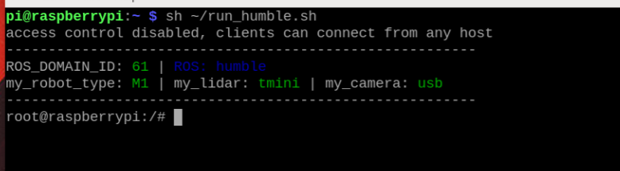
_로봇 컨테이너는 진입할 때 `ROS_DOMAIN_ID`와 로봇·라이다·카메라 설정을 보여 준다_

### 토픽

```bash
ros2 topic list -t                    # 토픽 + 메시지 타입
ros2 topic info -v /scan              # 발행자/구독자 수와 QoS
ros2 topic hz /scan                   # 발행 주기 (라이다 약 10Hz)
ros2 topic bw /usb_cam/image_raw      # 대역폭 (카메라가 WiFi에 무거운지)
ros2 topic echo /voltage --once       # 메시지 한 번 출력
ros2 topic pub --once /cmd_vel geometry_msgs/msg/Twist \
  "{linear: {x: 0.1}, angular: {z: 0.0}}"   # 직접 발행 (로봇이 움직임)
ros2 interface show sensor_msgs/msg/LaserScan   # 메시지 구조
```

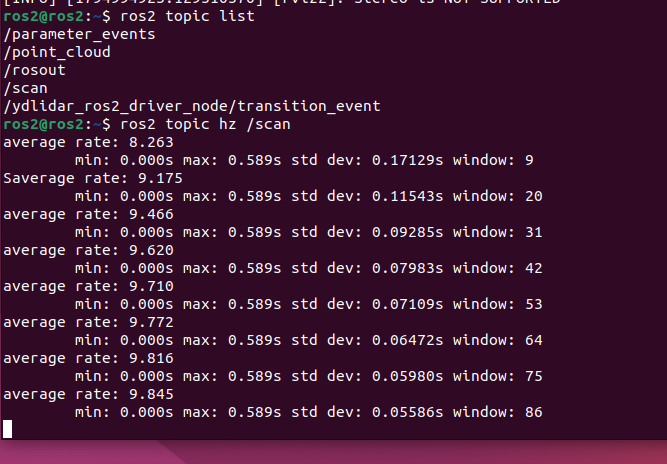
_노트북 VM에서 `ros2 topic list`와 `ros2 topic hz /scan`을 실행한 화면. 로봇의 `/scan`이 약 9.8Hz로 들어온다_

### 노드·서비스·파라미터

```bash
ros2 node list
ros2 node info /ydlidar_ros2_driver_node   # 이 노드가 주고받는 것 전부
ros2 service list
ros2 param list /usb_cam
ros2 param get /usb_cam framerate
ros2 action list
```

### 실행

```bash
ros2 run <패키지> <실행파일>           # 노드 하나
ros2 launch <패키지> <파일>.launch.py    # 여러 노드 묶음
ros2 pkg executables yahboomcar_bringup    # 패키지 안 실행 파일 목록
ros2 launch ydlidar_ros2_driver ydlidar_launch.py --show-args   # launch 인자 확인
```

> [!TIP]
> 패키지 이름은 직접 치지 말고 Tab으로 자동완성한다. 2탄의 오타 두 건이 이걸로 막힌다.

### TF·기록·GUI

```bash
ros2 run tf2_ros tf2_echo map base_link    # 두 좌표계 사이 변환
ros2 run tf2_tools view_frames              # TF 트리를 frames.pdf로 저장
ros2 bag record /scan /tf /tf_static        # 데이터 녹화
ros2 bag play <폴더>                      # 로봇 없이 재생
rqt_graph                                   # 노드-토픽 연결 그림
ros2 run rqt_image_view rqt_image_view      # 카메라 영상만 빠르게 보기
```

### 우리 로봇 전용

```bash
ssh pi@192.168.1.11
sh ~/run_humble.sh                                          # 컨테이너 실행
docker exec -it -e DISPLAY=:0 $(docker ps -q) /bin/bash     # 추가 터미널
ros2 run yahboomcar_bringup Mcnamu_driver_M1                # 차체 드라이버
ros2 run yahboomcar_ctrl yahboom_keyboard                   # 키보드 조종
ros2 launch ydlidar_ros2_driver ydlidar_launch.py           # 라이다
ros2 launch usb_cam camera.launch.py                        # 카메라
ros2 launch yahboomcar_nav map_slam_toolbox_launch.py       # SLAM
ros2 launch yahboomcar_nav save_map_launch.py               # 지도 저장
```

## rviz2 사용 설명서

rviz2는 토픽을 구독해서 3D로 그려주는 뷰어다. 스스로 데이터를 만들지 않으므로, 화면이 비어 있으면 토픽·Fixed Frame·QoS 세 가지를 확인하면 된다. 노트북 VM에서 `rviz2`로 실행한다.

### 화면 구성

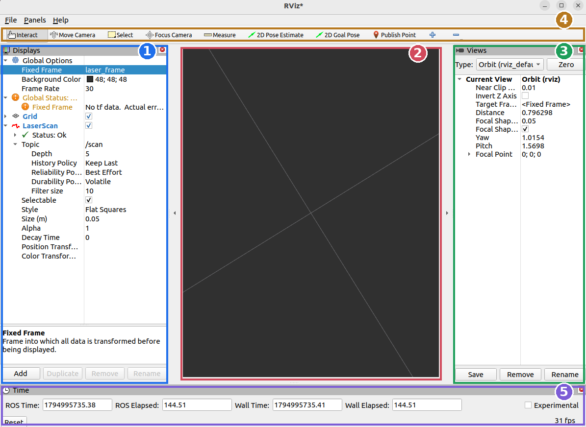
_rviz2 화면 구성. 번호는 아래 표와 같다_

| 영역 | 역할 |
| --- | --- |
| ① Displays (왼쪽) | 무엇을 그릴지 목록. Global Options의 Fixed Frame이 여기 있다 |
| ② 3D 뷰 (가운데) | 실제 화면. 왼쪽 드래그 회전, 휠 줌, Shift+드래그 이동 |
| ③ Views (오른쪽) | 카메라 시점. Orbit(기본), TopDownOrtho(지도 볼 때 편함) |
| ④ 도구줄 (위) | Interact, 2D Pose Estimate, 2D Goal Pose, Publish Point |
| ⑤ Time (아래) | ROS 시간, 우측 하단 fps |

### 기본 순서

1. **Fixed Frame**을 정한다. 라이다만: `laser_frame`, SLAM·Nav2 실행 중: `map`, 오도메트리만: `odom`
2. 왼쪽 아래 **Add → By topic** 탭에서 토픽을 고른다. By display type보다 토픽이 자동으로 채워져 편하다
3. 추가한 항목을 펼쳐 **Status**가 초록인지 본다. 주황/빨강이면 메시지에 원인이 적혀 있다
4. **Topic → Reliability / Durability**를 발행자에 맞춘다
5. 보기 설정(Size, Color)을 조절한다
6. **File → Save Config As**로 `.rviz` 파일을 저장해 두고, 다음부터 `rviz2 -d ~/m1_slam.rviz`로 바로 연다

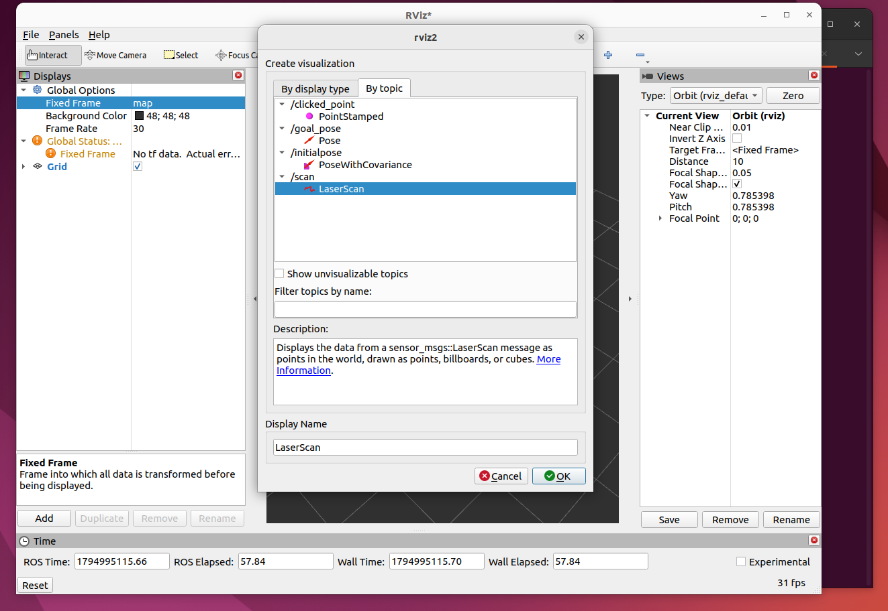
_2번 단계의 Add → By topic 창. 뒤쪽 Displays에는 Fixed Frame이 `map`이라 `No tf data` 경고가 떠 있다 (1번 단계를 건너뛴 경우)_

### Display별 설정

| Display | 토픽 | 바꿔야 할 것 |
| --- | --- | --- |
| LaserScan | `/scan` | Reliability **Best Effort**, Size 0.05~0.1, Color Transformer Intensity |
| PointCloud2 | `/point_cloud` | Best Effort. 라이다 점을 3D 점군으로 |
| Map | `/map` | Durability **Transient Local**, Fixed Frame `map` |
| TF | (토픽 없음) | Show Names 켜면 좌표계 이름 표시. TF 문제 진단용 |
| RobotModel | `/robot_description` | Description Source를 Topic으로, Durability Transient Local |
| Odometry | `/odom` | Keep 값을 줄여 화살표 개수 제한 |
| Image / Camera | `/usb_cam/image_raw` | Transport를 **compressed**로, Best Effort. Camera는 TF가 필요하므로 영상만 볼 땐 Image |
| Path | `/plan` | Nav2 경로 표시 (3탄) |

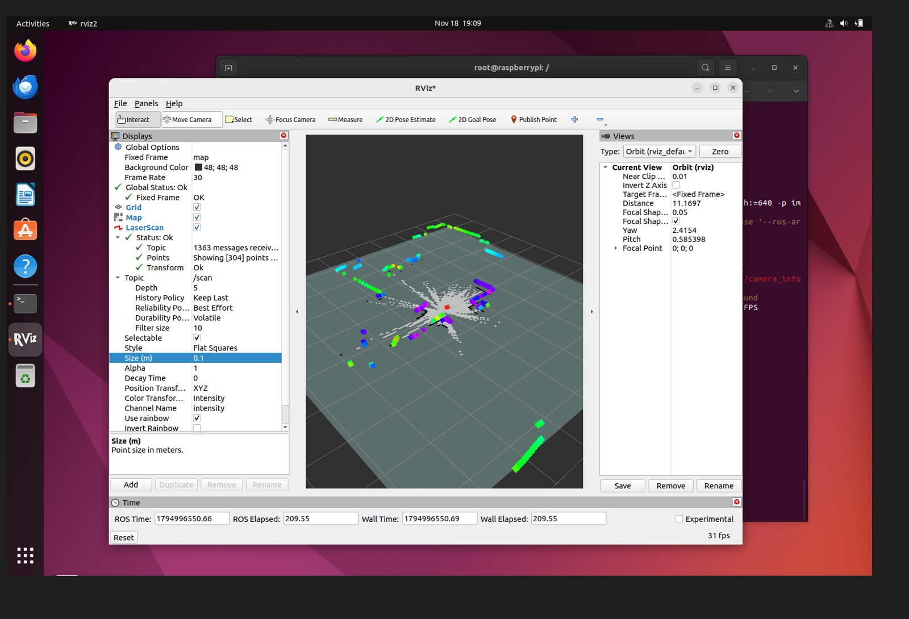
_Fixed Frame `map`, Map과 LaserScan을 추가한 결과. 회색이 지도, 컬러 점이 현재 라이다 스캔이다 (2탄)_

### 도구줄 버튼이 하는 일

| 버튼 | 발행하는 토픽 | 쓰는 때 |
| --- | --- | --- |
| 2D Pose Estimate | `/initialpose` | 저장된 지도 위에 로봇의 시작 위치를 알려줄 때 |
| 2D Goal Pose | `/goal_pose` | Nav2에게 목표 지점을 줄 때 |
| Publish Point | `/clicked_point` | 지도의 좌표 확인 |

이 버튼들은 rviz가 읽기만 하는 도구가 아니라 **토픽을 발행하는 노드**라는 뜻이다. 노트북에서 로봇을 움직일 수 있는 이유이기도 하다.

### 성능 요령

- rviz는 라즈베리파이가 아니라 노트북에서 띄운다 (Pi는 GPU 가속 미지원)
- 카메라는 raw(프레임당 약 900KB) 대신 compressed를 구독하고, framerate를 15~30으로 낮춘다
- 안 보는 Display는 체크를 해제한다. 체크 해제하면 구독도 멈춘다

## 자주 막히는 문제와 확인 순서

아래층부터 위로(물리 → 네트워크 → ROS → 화면) 확인하면 원인을 가장 빨리 찾는다.

1. 장치가 있나: `lsusb`, `ls -l /dev/rplidar /dev/myserial /dev/video0`
2. 노드가 떴나: 로봇 컨테이너에서 `ros2 node list`, launch 로그에 ERROR가 없는지
3. 네트워크가 되나: 노트북에서 `ping 192.168.1.11`, `ros2 multicast send/receive`
4. 같은 도메인인가: 양쪽 `echo $ROS_DOMAIN_ID` = 61
5. 토픽이 오나: 노트북에서 `ros2 topic list`, `ros2 topic hz`
6. QoS가 맞나: `ros2 topic info -v`
7. 좌표계가 있나: rviz Fixed Frame, `tf2_echo`

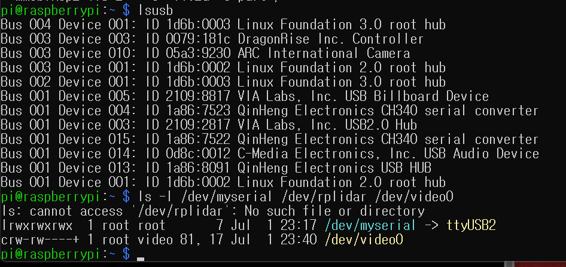
_1번 단계의 예. `lsusb`에 라이다(10c4:ea60)가 없고 `/dev/rplidar`도 없다. 케이블을 다시 꽂아 해결했다 (2탄)_

| 증상 | 원인 | 해결 |
| --- | --- | --- |
| `cannot bind to /dev/rplidar` | 라이다 USB 미연결, 또는 경로가 디렉토리로 생김 | 케이블 확인, `rmdir`, udev 규칙 |
| `Package ... not found` | 패키지·launch 이름 오타, 또는 컨테이너 밖에서 실행 | Tab 자동완성, 컨테이너 안인지 확인 |
| 노트북에서 토픽이 기본 2개뿐 | DOMAIN_ID 불일치, VM이 NAT, 방화벽 | 브리지 + 무작위 모드 허용, 같은 ID |
| 토픽은 보이는데 `echo`가 안 나옴 | QoS 불일치, 또는 멀티캐스트만 되고 유니캐스트가 막힘 | `--qos-reliability best_effort`, 방화벽 UDP 허용 |
| rviz `No tf data` | Fixed Frame의 좌표계가 없음 | 라이다만이면 `laser_frame` |
| rviz Status OK, 0 points | Reliability 불일치 | Best Effort |
| rviz Map 안 보임 | Durability 불일치 | Transient Local |
| 카메라 화면이 안 나옴 / 끊김 | raw 이미지가 WiFi에 무겁고 framerate 120 | compressed, framerate 낮추기 |
| 라즈베리파이 rviz 렉 | GPU 가속 불가 (V3D) | 노트북에서 rviz |
| 장치가 번갈아 사라짐 | USB 포트 부족 | 허브 활용, 불필요한 장치 제거 |
