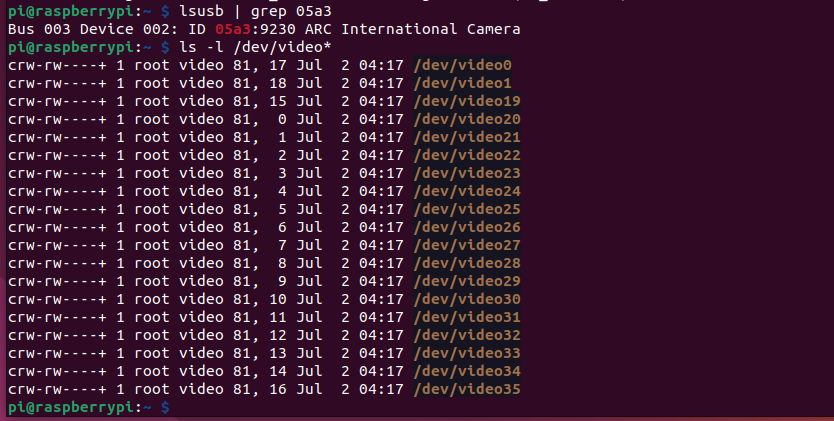
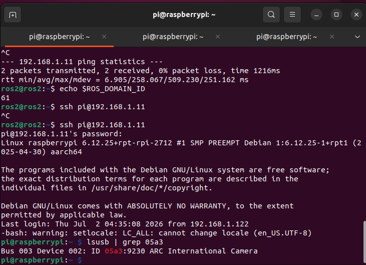
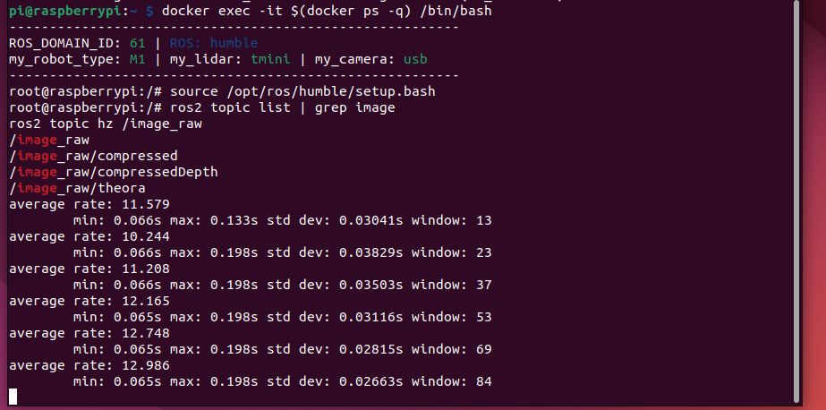
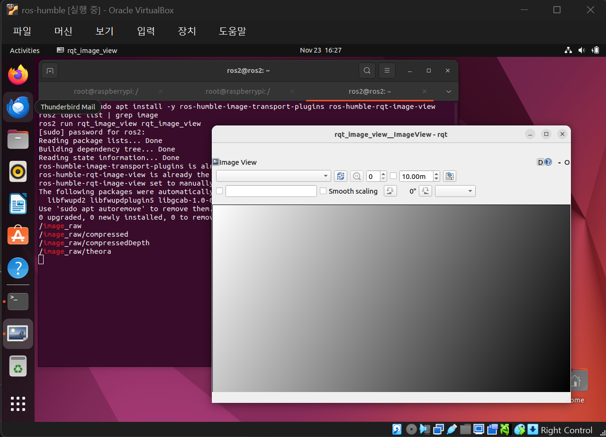
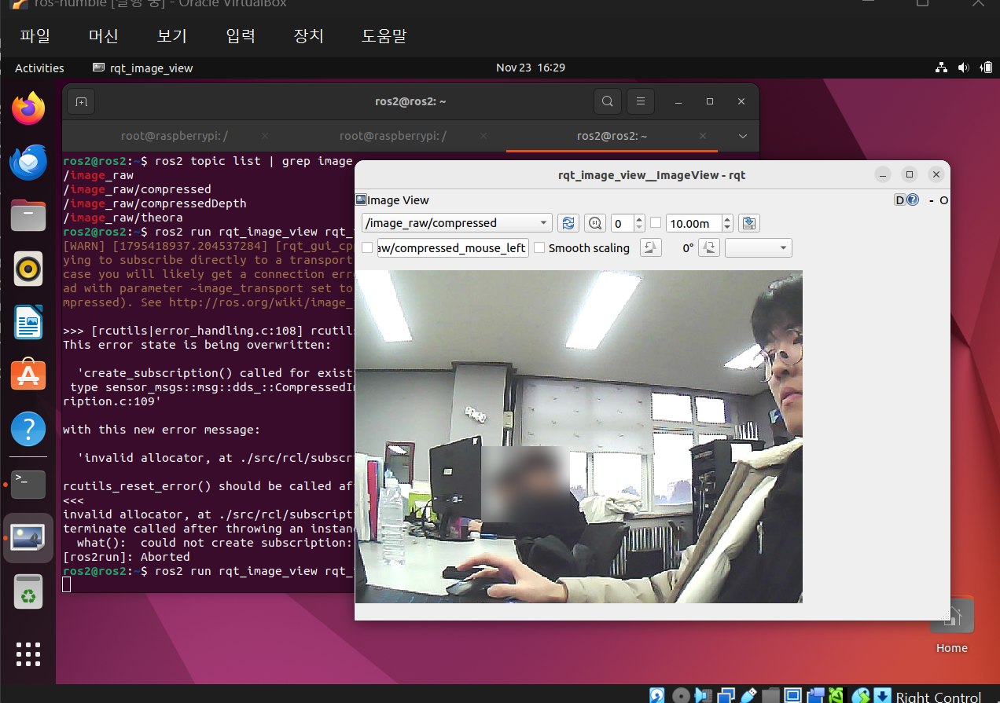
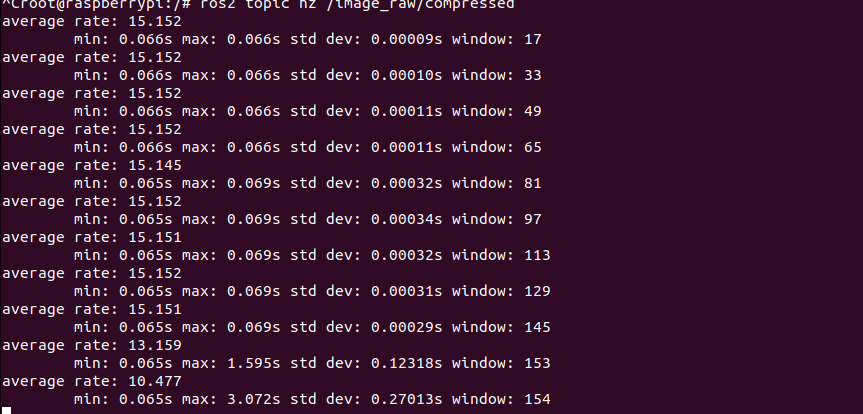
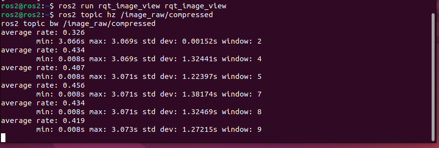

## 들어가며

2탄에서는 라이다와 SLAM 지도까지 노트북 rviz에 띄웠지만 **카메라만 해결하지 못했다.** 이번 편은 그 마무리다.

결론부터 말하면 카메라 자체는 처음부터 멀쩡했다. 문제는 **네트워크 경로**였다.

| 항목 | 해결 전 | 해결 후 |
| --- | --- | --- |
| 로봇 ↔ 노트북 연결 | WiFi | **랜선 직결** (WiFi는 인터넷용) |
| 로봇 ping | 평균 258ms, 최대 509ms | 1ms 미만 |
| 파이 발행 속도 | 15.15Hz | 15.15Hz |
| 노트북 수신 속도 | **0.4Hz** (약 3초에 1장) | **15.15Hz** |

## 결과 영상

손을 흔들면 노트북 화면의 영상도 지연 없이 따라 움직인다.

<video class="narrow" controls playsinline preload="metadata" poster="/assets/video/rosmaster-m1-2fix/camera-15hz-demo-poster.jpg">
  <source src="/assets/video/rosmaster-m1-2fix/camera-15hz-demo.mp4" type="video/mp4">
</video>

---

## 1. 카메라 장치부터 확인

먼저 하드웨어 문제가 아닌지 확인했다. 파이 본체(컨테이너 밖)에서 실행한다.

```bash
lsusb | grep 05a3
ls -l /dev/video*
```


_카메라(05a3:9230)가 잡혀 있고 `/dev/video0`, `/dev/video1`이 있다_

`/dev/video19~35`는 라즈베리파이5 자체의 코덱·ISP 장치라 신경 쓰지 않아도 된다. USB 카메라는 보통 두 개의 장치를 만드는데, <strong>영상은 <code>video0</code></strong>이고 `video1`은 메타데이터 전용이다.

이때 WiFi로 접속해 있었는데, ping이 평균 258ms, 최대 509ms까지 튀었다. 이게 나중에 중요한 단서가 된다.


_WiFi 너머 로봇까지 ping 평균 258ms_

## 2. 카메라 노드 실행

2탄에서는 launch 파일 기본값(120fps)으로 실행해서 너무 무거웠다. 이번에는 파라미터를 직접 지정했다. 컨테이너 안에서 실행한다.

```bash
sh ~/run_humble.sh            # 컨테이너 진입
ros2 run usb_cam usb_cam_node_exe --ros-args \
  -p video_device:=/dev/video0 \
  -p image_width:=640 -p image_height:=480 \
  -p framerate:=15.0 \
  -p pixel_format:=mjpeg2rgb
```

다른 터미널에서 같은 컨테이너로 들어가 토픽을 확인한다.

```bash
docker exec -it $(docker ps -q) /bin/bash
source /opt/ros/humble/setup.bash
ros2 topic list | grep image
ros2 topic hz /image_raw
```


_`/image_raw`와 압축 토픽 `/compressed`, `/theora`가 함께 발행된다_

> [!WARNING]
> **시행착오: `ros2: command not found`**
> 노트북 VM에서 칠 설치 명령을 **파이 본체**(`pi@raspberrypi`)에 입력했다. 이 로봇의 ROS2는 Docker 컨테이너 안에만 있어서, 본체에는 `ros2`도 `ros-humble-*` 패키지도 없다. 프롬프트로 어디에 있는지 구분하는 습관이 필요하다.
>
> | 프롬프트 | 위치 |
> | --- | --- |
> | `pi@raspberrypi:~ $` | 파이 본체 |
> | `root@raspberrypi:/#` | 파이 컨테이너 (ROS2 있음) |
> | `ros2@ros2:~$` | 노트북 VM |

## 3. 노트북에서 영상 보기

노트북 VM에서 압축 영상 플러그인과 이미지 뷰어를 설치한다. **플러그인이 없으면 rviz도 압축 영상을 풀지 못한다.** 2탄에서 화면이 안 나온 원인 중 하나다.

```bash
sudo apt install -y ros-humble-image-transport-plugins ros-humble-rqt-image-view
ros2 run rqt_image_view rqt_image_view
```


_회색 그라데이션은 고장이 아니라 토픽을 아직 고르지 않은 기본 화면이다_

새로고침 버튼을 누르고 `/image_raw/compressed`를 선택하면 영상이 나온다.


_영상은 나온다. 그런데 5초에 한 장 정도로 뚝뚝 끊긴다_

## 4. 느린 원인 찾기: 양쪽에서 측정

영상이 나오긴 하는데 너무 느렸다. 원인이 파이인지 네트워크인지 가르기 위해 **같은 토픽의 주기를 양쪽에서 쟀다.**

```bash
ros2 topic hz /image_raw/compressed
```


_파이(컨테이너): 15.15Hz로 정확히 발행. 그런데 마지막 두 줄에서 노트북이 구독을 시작하자 10Hz로 떨어지고 최대 간격이 3초로 튄다_


_노트북 VM: 0.4Hz. 간격이 정확히 약 3.07초씩이다_

여기서 세 가지를 알 수 있었다.

1. 파이는 정상이다. 15Hz로 잘 만들어 보내고 있다.
2. 노트북은 **약 3초마다 한 장**씩 받는다. 간격이 일정하다는 건 랜덤한 끊김이 아니라 어떤 타이머에 묶여 있다는 뜻이다.
3. 노트북이 구독하자 **파이 쪽 발행까지 느려졌다.** 받는 쪽이 보내는 쪽을 붙잡고 있다는 신호다.

### 왜 3초인가: DDS 재전송

640x480 JPEG 한 장은 UDP 패킷 하나에 다 들어가지 않아서 여러 조각으로 나뉘어 전송된다. 구독 QoS가 **Reliable**이면 조각 하나라도 잃었을 때 재전송을 받아야 그 프레임이 완성된다. DDS는 주기적으로 "빠진 거 있어?"를 묻는 heartbeat를 보내는데, 이 재시도 주기에 걸려 약 3초마다 한 장씩만 완성된 것이다. Reliable 발행자는 느린 구독자 때문에 버퍼가 차면 발행도 같이 밀린다. 파이 쪽이 10Hz로 떨어진 이유다.

조각을 잃어버린 원인은 두 가지였다.

- **VM에 WiFi(enp0s3)와 랜선(enp0s8)이 둘 다 연결**돼 있어서, DDS가 느리고 불안정한 WiFi 경로로도 데이터를 주고받았다
- 리눅스 기본 **UDP 수신 버퍼(약 208KB)가 작아서** 조각이 몰리면 버려졌다

## 5. 해결 1: 랜선 직결

WiFi ping이 수백 ms씩 튀는 걸 보고 노트북과 로봇을 **랜선으로 직접 연결**했다.

### VirtualBox 설정

VM을 끈 상태에서 설정 → 네트워크.

| 어댑터 | 연결 | 용도 |
| --- | --- | --- |
| 어댑터 1 | 브리지 → 노트북 **WiFi 카드** | 인터넷 (기존 그대로) |
| 어댑터 2 (추가) | 브리지 → 노트북 **유선 랜카드**, 무작위 모드 "모두 허용" | 로봇 전용 |

### IP 고정

직결에는 IP를 나눠줄 공유기가 없으므로 양쪽에 직접 넣는다. **WiFi 대역(192.168.1.x)과 다른 대역**을 써야 한다.

라즈베리파이 (Raspberry Pi OS는 NetworkManager 사용):

```bash
sudo nmcli con add type ethernet ifname eth0 con-name direct \
  ipv4.method manual ipv4.addresses 192.168.10.1/24
sudo nmcli con up direct
```

노트북 VM (Ubuntu, netplan도 가능):

```yaml
# /etc/netplan/99-direct.yaml
network:
  version: 2
  renderer: NetworkManager
  ethernets:
    enp0s8:
      dhcp4: false
      addresses: [192.168.10.2/24]
```

```bash
sudo chmod 600 /etc/netplan/99-direct.yaml
sudo netplan apply
ping -c 3 192.168.10.1
ssh pi@192.168.10.1
```

게이트웨이는 넣지 않는다. 넣으면 인터넷 트래픽이 랜선 쪽으로 빠져 WiFi 인터넷이 끊길 수 있다.

> [!DANGER]
> **시행착오: VM에 파이 IP를 넣음**
> 처음에 VM의 enp0s8에 파이 주소인 `192.168.1.11`을 그대로 넣었다. ping이 0.03ms로 너무 빨리 왔는데, **VM이 자기 자신한테 ping을 보낸 것**이었다. 게다가 VM의 WiFi 어댑터도 같은 192.168.1.x 대역이라 파이와 IP가 충돌했다. 랜선 쪽은 반드시 별도 대역(192.168.10.x)을 써야 한다.
>
> 구분하는 법: 같은 컴퓨터 안 응답은 0.03ms 수준, 랜선 너머는 보통 0.3~1ms다.

랜선으로 바꾸자 SSH와 명령 반응 속도가 체감될 만큼 빨라졌다. 하지만 **카메라는 여전히 느렸다.** VM의 WiFi 어댑터가 살아 있어서 DDS가 그쪽 경로를 계속 섞어 쓰고 있었기 때문이다.

## 6. 해결 2: VM의 WiFi 경로 끄기 + 수신 버퍼 확장

노트북 VM에서 실행한다.

```bash
# 수신 버퍼 확장 (약 208KB → 32MB)
sudo sysctl -w net.core.rmem_max=33554432
sudo sysctl -w net.core.rmem_default=33554432

# WiFi 쪽 어댑터 끄기
nmcli -f DEVICE,TYPE,STATE dev
sudo nmcli dev disconnect enp0s3

# ROS 데몬이 예전 경로 정보를 들고 있으므로 재시작
ros2 daemon stop
ros2 topic hz /image_raw/compressed
```

```text
average rate: 14.985
	min: 0.059s max: 0.077s std dev: 0.00399s window: 17
average rate: 15.142
	min: 0.057s max: 0.077s std dev: 0.00370s window: 33
average rate: 15.150
	min: 0.057s max: 0.077s std dev: 0.00326s window: 65
average rate: 15.147
	min: 0.054s max: 0.078s std dev: 0.00362s window: 97
```

**0.4Hz → 15.15Hz.** 파이가 발행하는 속도 그대로 노트북에 도착한다. 최대 간격도 3초에서 0.078초로 줄었다.

버퍼 설정은 재부팅하면 사라지므로 파일로 고정해 둔다.

```bash
echo -e "net.core.rmem_max=33554432\nnet.core.rmem_default=33554432" \
  | sudo tee /etc/sysctl.d/60-ros2.conf
```

### 운영 규칙

- 로봇 작업 중에는 VM WiFi(enp0s3)를 끄고 랜선만 쓴다
- `apt install` 등 인터넷이 필요할 때만 `sudo nmcli dev connect enp0s3`으로 켠다
- 접속은 `ssh pi@192.168.10.1`

---

## 시행착오 요약

| # | 증상 | 원인 | 해결 |
| --- | --- | --- | --- |
| 1 | 2탄에서 카메라가 무겁고 안 보임 | launch 기본 120fps, VM에 압축 플러그인 없음 | 640x480 15fps 직접 지정, `image-transport-plugins` 설치 |
| 2 | `ros2: command not found` | VM용 명령을 파이 본체에 입력 | 프롬프트로 위치 확인 |
| 3 | rqt 회색 화면 | 토픽 미선택 | 새로고침 후 `/image_raw/compressed` 선택 |
| 4 | WiFi ping 258ms | 무선 구간 지연 | 랜선 직결 |
| 5 | ping 0.03ms인데 통신 안 됨 | VM에 파이 IP를 넣어 자기 자신에게 ping + IP 충돌 | 별도 대역 192.168.10.x |
| 6 | 노트북 0.4Hz (3초에 1장) | WiFi·랜선 경로 혼용 + Reliable 재전송 + 작은 UDP 버퍼 | VM WiFi 끄기, `rmem` 32MB, 데몬 재시작 |

## 배운 것

- **양쪽에서 같은 것을 측정하면 원인이 반으로 줄어든다.** 파이 15Hz / VM 0.4Hz를 보는 순간 카메라 문제가 아니라는 게 확정됐다.
- 일정한 간격의 끊김(정확히 3초)은 랜덤한 손실이 아니라 **프로토콜의 타이머**를 의심할 단서다.
- DDS는 쓸 수 있는 인터페이스를 전부 쓴다. 네트워크가 여러 개면 **느린 쪽이 전체를 끌어내릴 수 있다.**

## 다음 편 예고

이제 라이다·SLAM 지도와 카메라 영상을 **rviz 한 화면에** 띄울 수 있다. 3탄에서는 이 상태로 키보드 조종을 하며 방 전체 지도를 완성해 저장하고, Nav2로 그 지도 위에서 목표 지점까지 자율주행한다. 그리고 랜선 직결 구성은 앞으로 실습의 기본 환경이 된다.
