## 들어가며

1탄에서 하드웨어 조립을 끝냈고, 이번 2탄에서는 소프트웨어 쪽을 다뤘다. 최종적으로 도달한 지점은 다음과 같다.

- 라즈베리파이5 안의 Docker 컨테이너에서 ROS2 Humble 실행
- YDLIDAR Tmini Plus 라이다 정상 동작 (`/scan` 약 10Hz)
- 노트북 VirtualBox에 Ubuntu 22.04 + ROS2 Humble 설치, **WiFi 너머로 로봇 토픽 수신**
- 노트북 rviz2에서 **slam_toolbox 지도 생성 확인**
- 카메라: 토픽(`/usb_cam/image_raw`)은 올라오지만 화면 표시는 아직 해결 중

한 번에 된 건 거의 없었다. 그래서 이 글은 "이렇게 하면 된다"보다 **"이렇게 막혔고 이렇게 풀었다"** 위주로 정리했다. 막힌 지점은 글 끝의 [시행착오 요약](#시행착오-요약)에 표로 모았다.

## 결과 영상

로봇을 손으로 들어 돌리면 노트북 rviz의 스캔과 지도가 같이 회전한다.

<video controls playsinline preload="metadata" poster="/assets/video/rosmaster-m1-2/slam-demo-poster.jpg">
  <source src="/assets/video/rosmaster-m1-2/slam-demo.mp4" type="video/mp4">
</video>

## 전체 구조

```text
[라즈베리파이5]                                  [노트북 VirtualBox VM]
 Docker (ros-humble-m1)                           Ubuntu 22.04 + ROS2 Humble
  ├ ydlidar_ros2_driver  → /scan                   └ rviz2  (지도·스캔 시각화)
  ├ slam_toolbox         → /map, /tf
  ├ usb_cam              → /usb_cam/image_raw
  └ Mcnamu_driver_M1     ↔ /cmd_vel, /imu ...
              ────── WiFi (같은 공유기, DDS 멀티캐스트, ROS_DOMAIN_ID=61) ──────
```

무거운 계산(드라이버, SLAM)은 로봇에서, 무거운 그래픽(rviz)은 노트북에서 돌리는 구조다. 이 구조로 오기까지가 이번 글의 대부분이다.

---

## 1. 접속과 컨테이너 진입

```bash
ssh pi@192.168.1.11          # 라즈베리파이 접속
sh ~/run_humble.sh           # ROS2 Docker 컨테이너 실행
# 다른 터미널에서 같은 컨테이너로 추가 진입
docker exec -it -e DISPLAY=:0 $(docker ps -q) /bin/bash
```

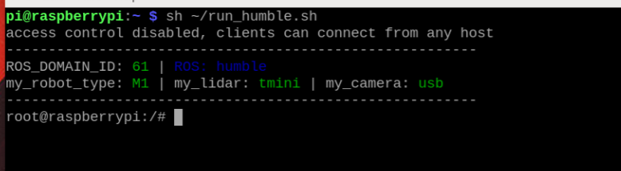
_진입하면 ROS_DOMAIN_ID 61, 로봇 M1, 라이다 tmini, 카메라 usb 설정이 표시된다_

> [!TIP]
> **시행착오: SSH가 느림**
> 접속과 타이핑이 꽤 느렸다. 원인은 sshd의 역방향 DNS 조회(UseDNS)와 WiFi 절전 모드로 추정됐는데, 고치는 대신 IP로 바로 접속하는 방식으로 그냥 진행했다. 작업에 지장이 있을 정도는 아니었다.

## 2. USB 장치 확인과 라이다 인식

로봇에 달린 USB 장치는 이렇다.

| 장치 | USB ID | 장치 파일 |
|---|---|---|
| 확장보드(STM32, CH340) | 1a86:7523 | `/dev/myserial` |
| 라이다 Tmini Plus (CP210x) | 10c4:ea60 | `/dev/rplidar` |
| USB 카메라 | 05a3:9230 | `/dev/video0` |
| 음성 모듈 (허브+오디오+시리얼) | 1a86:8091 / 0d8c:0012 / 1a86:7522 | - |
| 게임패드 수신기 | 0079:181c | - |

```bash
lsusb
ls -l /dev/myserial /dev/rplidar /dev/video0
```

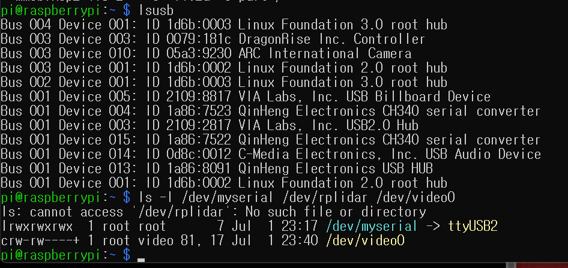
_처음엔 `/dev/rplidar`가 없었다_

> [!WARNING]
> **시행착오: `/dev/rplidar`가 없다 / `cannot bind to /dev/rplidar`**
> - `/dev/rplidar`가 심볼릭 링크가 아니라 **빈 디렉토리**로 생겨 있었다 → `rmdir`로 삭제
> - 더 근본적인 원인은 **라이다(10c4:ea60)가 USB에 아예 안 잡혀 있었던 것**이다. 처음엔 1a86:7522를 라이다로 착각했는데, 그건 음성 모듈의 시리얼 장치였다
> - 라이다 케이블을 다시 연결하니 10c4:ea60이 잡혔고, 이미 있던 udev 규칙(`ydlidar.rules`)이 `/dev/rplidar`를 자동으로 만들어줬다

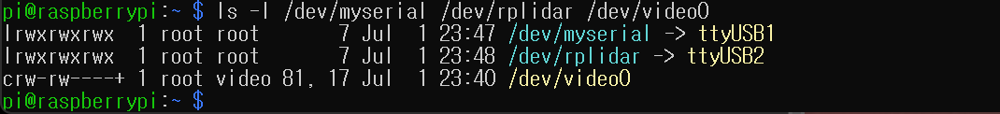
_해결 후: myserial, rplidar 둘 다 ttyUSB로 연결됨_

## 3. 배선 정리: USB 포트가 모자라다

라즈베리파이5의 USB-A 포트는 4개뿐이다. 음성 모듈, 카메라, 라이다, 게임패드 수신기, 허브를 꽂다 보니 하나를 꽂으면 다른 하나가 빠지는 상황이 반복됐다. 카메라가 갑자기 `/dev/video0 not available`이 된 것도 포트를 바꾸다 카메라가 빠졌기 때문이었다.

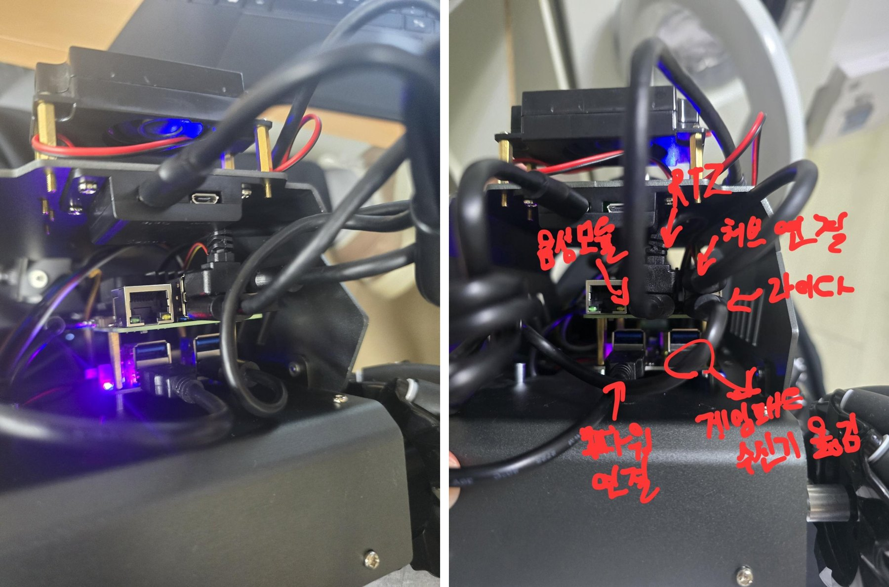
_왼쪽: 변경 전, 라즈베리파이 USB 포트가 꽉 찬 상태. 오른쪽: 변경 후, 음성모듈·PTZ 카메라·허브·라이다를 파이 포트에 꽂고 게임패드 수신기는 다른 곳으로 옮겼다_

**게임패드 수신기를 파이에서 빼서 옮기니** 포트가 하나 비었고, 그 뒤로 장치들이 서로 밀어내는 문제가 사라졌다.

> [!NOTE]
> **시행착오: 라이다 어댑터 보드의 포트**
> 라이다 어댑터 보드에 포트가 두 개 있어서 Power/Data 구분을 헷갈렸다. 데이터 쪽은 D-type 케이블로 연결하는 포트였다. 어느 포트에 꽂았는지보다 결국 `lsusb`에 10c4:ea60이 보이는지로 확인하는 게 확실했다.

## 4. 라이다 실행

```bash
ros2 launch ydlidar_ros2_driver ydlidar_launch.py
```

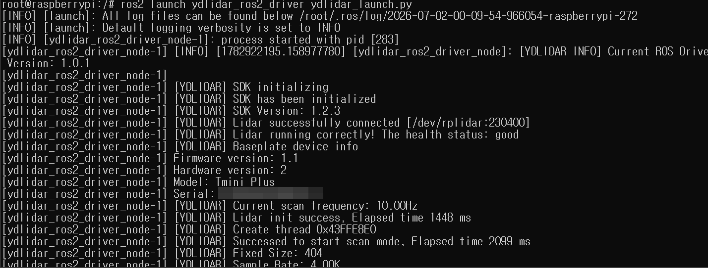
_`Lidar init success`, health good, 스캔 주파수 10Hz_

> [!WARNING]
> **시행착오: 패키지를 찾을 수 없다**
> `ydlidar_ros2driver`라고 입력했었다. 정확한 이름은 `ydlidar_ros2_driver`다 (언더바 하나 차이). 마찬가지로 카메라도 `cmera.launch.py`로 오타를 냈다. `ros2 launch <패키지>` 다음에 Tab을 누르면 자동완성되니 그걸 쓰는 게 낫다.

## 5. 카메라 (진행 중)

```bash
ros2 launch usb_cam camera.launch.py
```

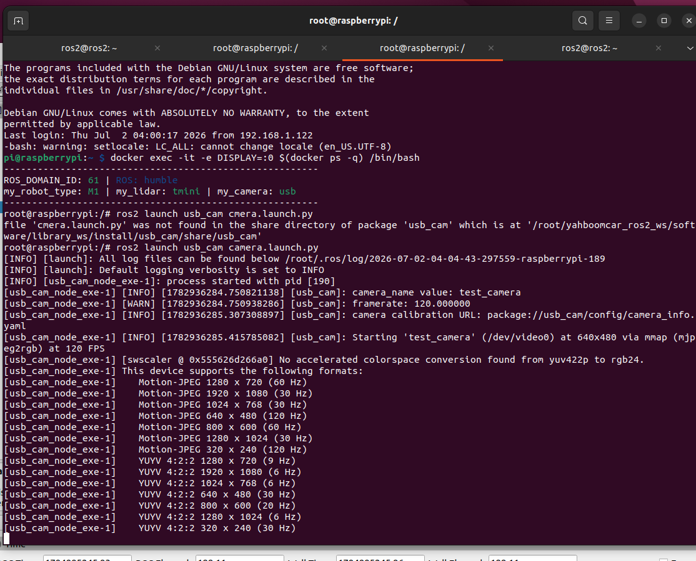
_카메라는 정상 인식. MJPEG 640x480 120Hz 등 지원 포맷이 나열된다_

카메라 노드 자체는 뜨고, 노트북에서도 `/usb_cam/image_raw` 토픽이 보인다. 다만 아직 rviz에 영상이 제대로 나오지 않는다. 지금까지 확인한 의심 지점은 다음과 같다.

- 기본 framerate가 **120fps**로 잡혀 있다. 라즈베리파이에서 디코딩하고 WiFi로 raw 이미지를 보내기엔 무겁다
- raw 이미지(640x480 RGB)는 프레임당 약 900KB라서 WiFi DDS로는 버겁다. `/image_raw/compressed`를 쓰는 쪽이 현실적이다

다음 편에서 framerate를 낮추고 compressed 토픽으로 다시 시도할 예정이다.

## 6. rviz를 라즈베리파이에서 띄웠더니 너무 느리다

처음엔 라즈베리파이 안에서 rviz2를 띄우고 VNC로 봤다.

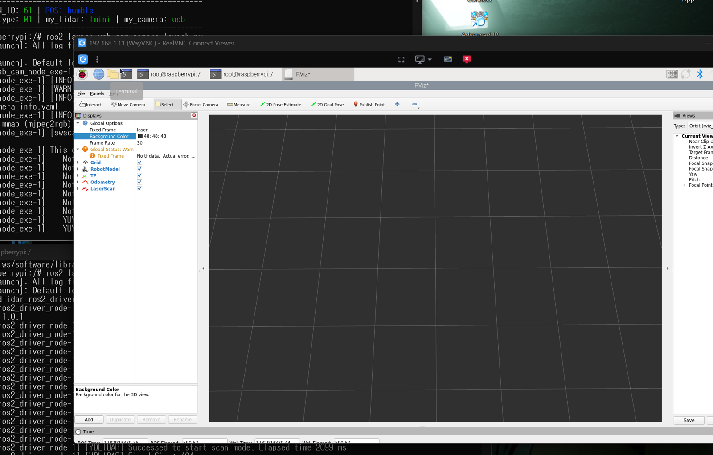
_라즈베리파이 + VNC에서 rviz. 뜨긴 뜨는데 거의 쓸 수 없을 정도로 느렸다_

> [!DANGER]
> **시행착오: rviz가 느림**
> 로그에 `V3D 7.1 not supported`가 찍혔다. 라즈베리파이5 GPU를 컨테이너 안의 Mesa가 제대로 못 써서 **CPU로 3D 렌더링**을 하고, 그걸 다시 VNC로 압축해서 보내니 느릴 수밖에 없었다. VNC 설정을 낮추는 걸로는 해결되지 않는다.
>
> **해결:** rviz는 노트북에서 돌린다. ROS2는 같은 네트워크·같은 `ROS_DOMAIN_ID`면 다른 컴퓨터의 토픽을 그대로 구독할 수 있다(DDS).

## 7. 노트북에 ROS2 VM 만들기

노트북이 Windows라서 VirtualBox에 Ubuntu 22.04.5를 설치했다. ROS2 Humble이 공식 지원하는 버전이다.

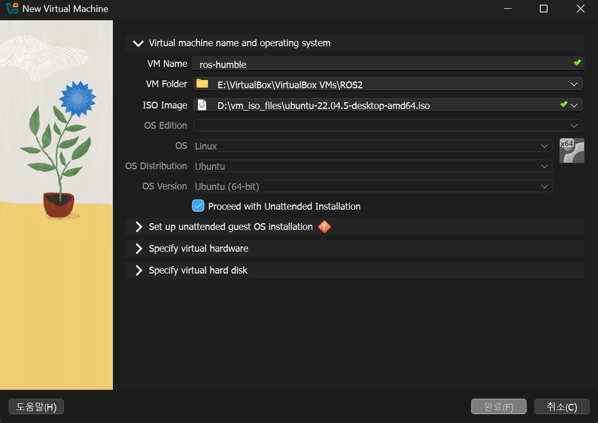
_VM 이름 `ros-humble`, Ubuntu 22.04.5 ISO 지정_

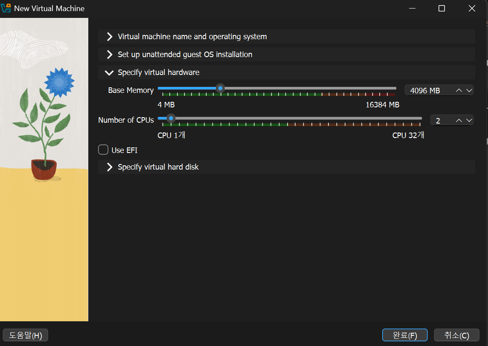
_메모리 4096MB, CPU 2개, 디스크 50GB_

**네트워크 설정이 핵심**이다. NAT로 두면 VM이 공유기 네트워크에 직접 보이지 않아 DDS 멀티캐스트가 안 된다.

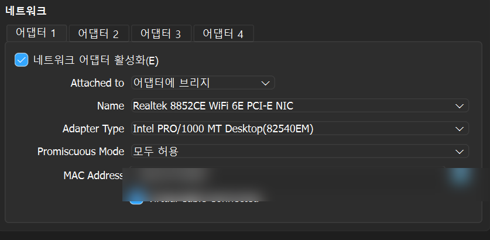
_어댑터에 브리지, 노트북 WiFi 카드 선택, 무작위 모드 "모두 허용"_

> [!WARNING]
> **시행착오: VM 터미널이 안 열림**
> 처음 만든 VM은 터미널을 누르면 로딩만 하다가 창이 안 떴고, 전체적으로 렉이 심했다. 로케일 문제와 3D 가속 설정이 겹친 것으로 보였는데, 고치느니 **VM을 새로 만들어서** 해결했다.

VM 안에서 설치한 것:

```bash
sudo apt install ros-humble-desktop ros-dev-tools
sudo apt install ros-humble-navigation2 ros-humble-nav2-bringup \
                 ros-humble-slam-toolbox ros-humble-teleop-twist-keyboard
echo 'source /opt/ros/humble/setup.bash' >> ~/.bashrc
echo 'export ROS_DOMAIN_ID=61' >> ~/.bashrc   # 로봇과 같은 값!
```

설치 확인은 데모 노드로 했다.

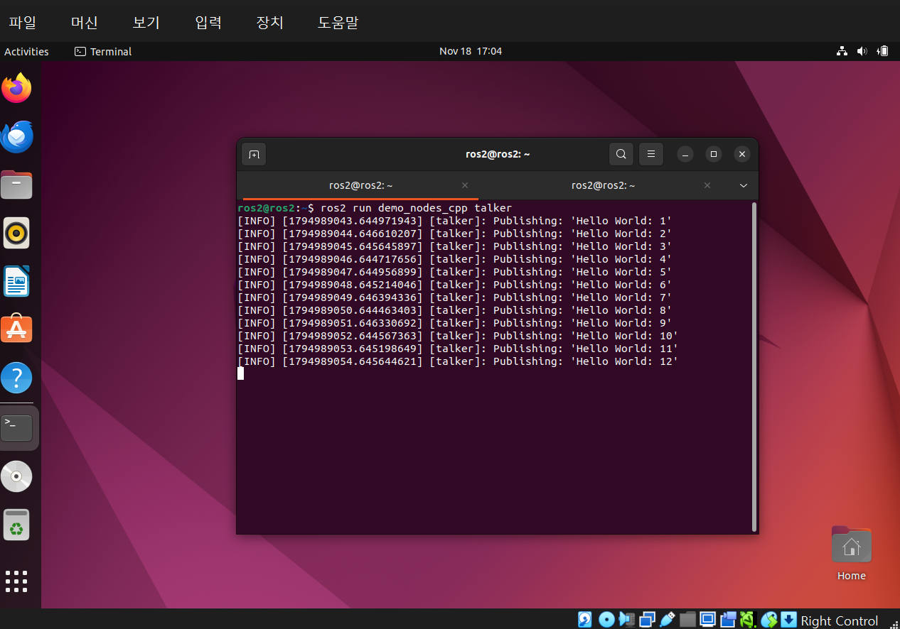
_VM 안에서 talker 실행_

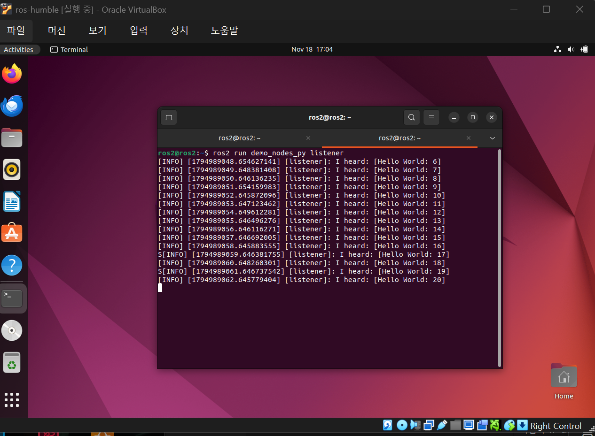
_다른 탭의 listener가 같은 메시지를 받는다_

## 8. VM ↔ 로봇 통신 확인

```bash
ping -c 3 192.168.1.11
ros2 topic list
ros2 topic hz /scan
```

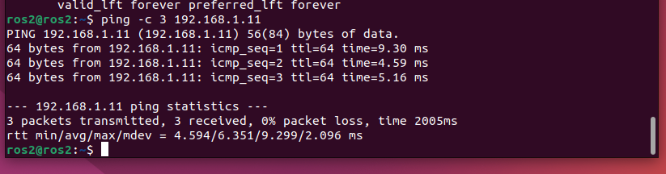
_VM에서 로봇까지 ping 0% loss_

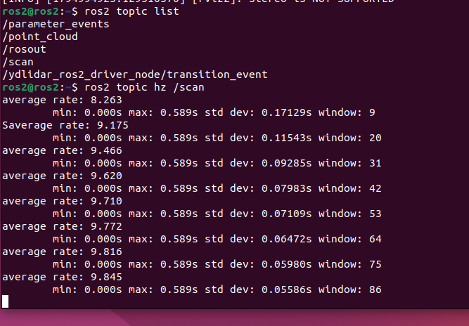
_노트북 VM에서 로봇의 `/scan`이 약 9.8Hz로 들어온다. WiFi 너머 DDS 통신 성공_

## 9. rviz2에서 라이다 보기

VM에서 `rviz2`를 실행하고 **Add → By topic → /scan → LaserScan**을 추가한다.

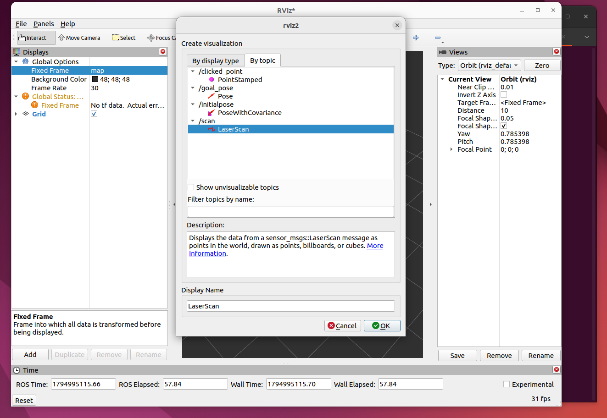
_By topic 탭에서 `/scan` 아래의 LaserScan을 고른다_

여기서 바로 보이지 않아 두 번 막혔다.

> [!DANGER]
> **시행착오 1: `No tf data` (Fixed Frame 오류)**
> Fixed Frame 기본값이 `map`인데, SLAM을 안 돌린 상태에선 `map` 좌표계가 존재하지 않는다. 라이다만 볼 때는 Fixed Frame을 **`laser_frame`**으로 바꿔야 한다.
>
> **시행착오 2: Status OK인데 점이 0개 (`Showing [0] points`)**
> rviz의 기본 QoS는 Reliability **Reliable**인데, 센서 드라이버는 보통 **Best Effort**로 발행한다. QoS가 안 맞으면 연결은 됐는데 데이터는 안 온다. LaserScan → Topic → Reliability Policy를 **Best Effort**로 바꾸니 바로 점이 찍혔다. 점 크기(Size)도 기본 0.01m는 너무 작아서 0.05~0.1로 키웠다.

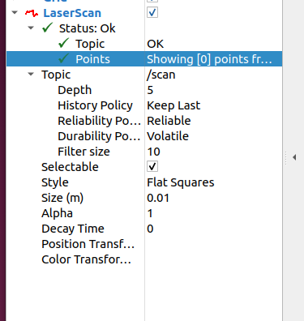
_Status는 OK인데 `Showing [0] points` — Reliability가 Reliable로 되어 있다_

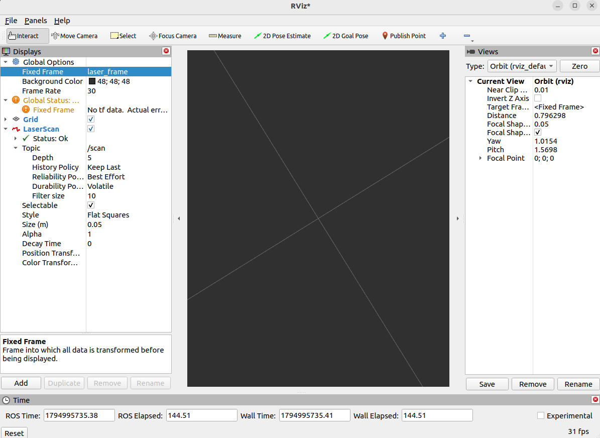
_Fixed Frame `laser_frame`, Reliability `Best Effort`로 변경_

## 10. SLAM 지도 만들기

로봇 컨테이너에서 slam_toolbox를 실행한다 (라이다 드라이버 포함).

```bash
ros2 launch yahboomcar_nav map_slam_toolbox_launch.py
```

로그에 `Registering sensor: [Custom Described Lidar]`가 뜨면 SLAM이 라이다를 잡은 것이다. 노트북 rviz에서 Fixed Frame을 다시 **`map`**으로 바꾸고 **Add → By topic → /map → Map**을 추가한다.

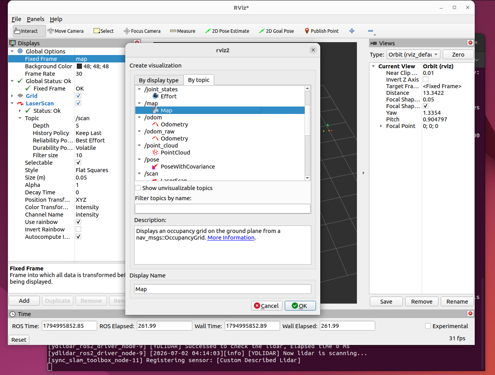
_slam_toolbox가 `/map`, `/tf`, `/odom` 등을 발행하면서 Global Status가 OK로 바뀌었다_

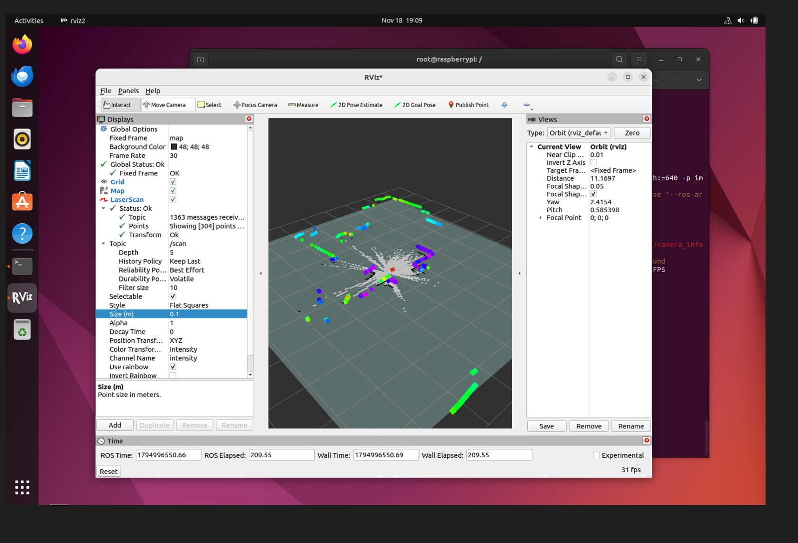
_회색이 생성 중인 점유 격자 지도, 컬러 점이 현재 라이다 스캔_

카메라 토픽도 함께 보이는 상태다.

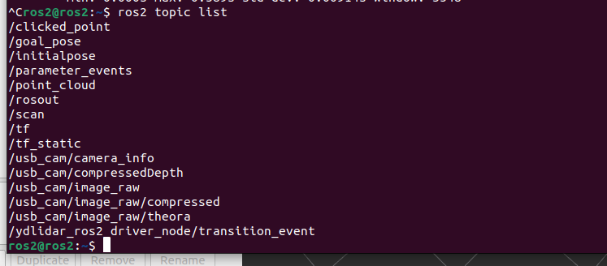
_노트북 VM의 토픽 목록에 `/usb_cam/...` 토픽이 올라와 있다_

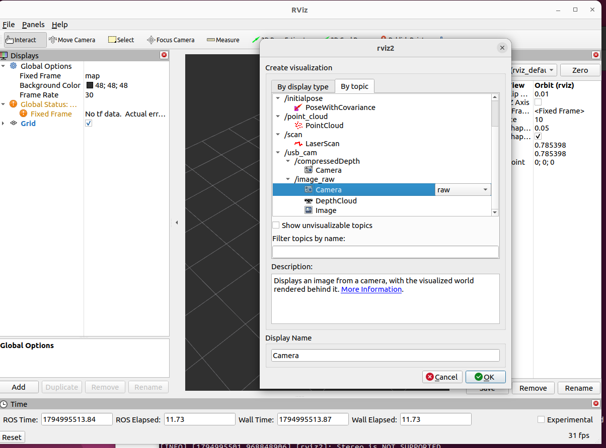
_rviz에서도 `/usb_cam/image_raw`를 Camera로 추가할 수 있다. 화면 표시는 다음 편에서 다룬다_

---

## 시행착오 요약

| # | 증상 | 원인 | 해결 |
|---|---|---|---|
| 1 | `cannot bind to /dev/rplidar` | 라이다가 USB에 안 잡힘 + 빈 디렉토리 | 케이블 재연결, `rmdir`, udev 규칙이 자동 생성 |
| 2 | 1a86:7522를 라이다로 착각 | 음성 모듈 시리얼이었음 | 라이다는 10c4:ea60 (CP210x) |
| 3 | 장치가 번갈아 사라짐 | 파이 USB 포트 4개 부족 | 게임패드 수신기 이동 |
| 4 | `/dev/video0 not available` | 포트 정리 중 카메라 빠짐 | 재연결 |
| 5 | 패키지 not found | 오타 (`ros2driver`, `cmera`) | Tab 자동완성 |
| 6 | Pi rviz 극심한 렉 | V3D 미지원 → CPU 렌더 + VNC | rviz를 노트북 VM으로 |
| 7 | VM 터미널 안 열림 | 로케일/3D 가속 | VM 재생성 |
| 8 | VM에서 토픽 안 보임 | NAT 네트워크 | 브리지 + 무작위 모드 허용 + 같은 DOMAIN_ID |
| 9 | rviz `No tf data` | SLAM 없이 Fixed Frame `map` | `laser_frame` (SLAM 후엔 `map`) |
| 10 | LaserScan 0 points | QoS Reliable vs Best Effort | Best Effort |
| 11 | SSH 느림 | DNS 조회 / WiFi 절전 추정 | IP로 직접 접속하고 진행 |
| 12 | SD 카드 사용량 82% | 이미지가 크고 rootfs가 카드 전체로 확장 안 됨 | `raspi-config`로 확장 예정 |

## 다음 편 예고

- 카메라 화면 띄우기 (framerate 낮추기, compressed 토픽)
- 키보드로 로봇을 움직이며 방 전체 지도 완성 → 저장
- Nav2로 저장한 지도 위에서 목표 지점 자율주행

그리고 이번에 확인한 사실 하나가 보안 편의 출발점이 된다. **같은 WiFi에 있고 `ROS_DOMAIN_ID`만 맞추면, 인증 없이 로봇의 센서 토픽을 그대로 구독할 수 있었다.** 내 노트북이 한 일은 다른 누군가도 할 수 있다는 뜻이다. 이건 4탄에서 직접 공격해볼 예정이다.
