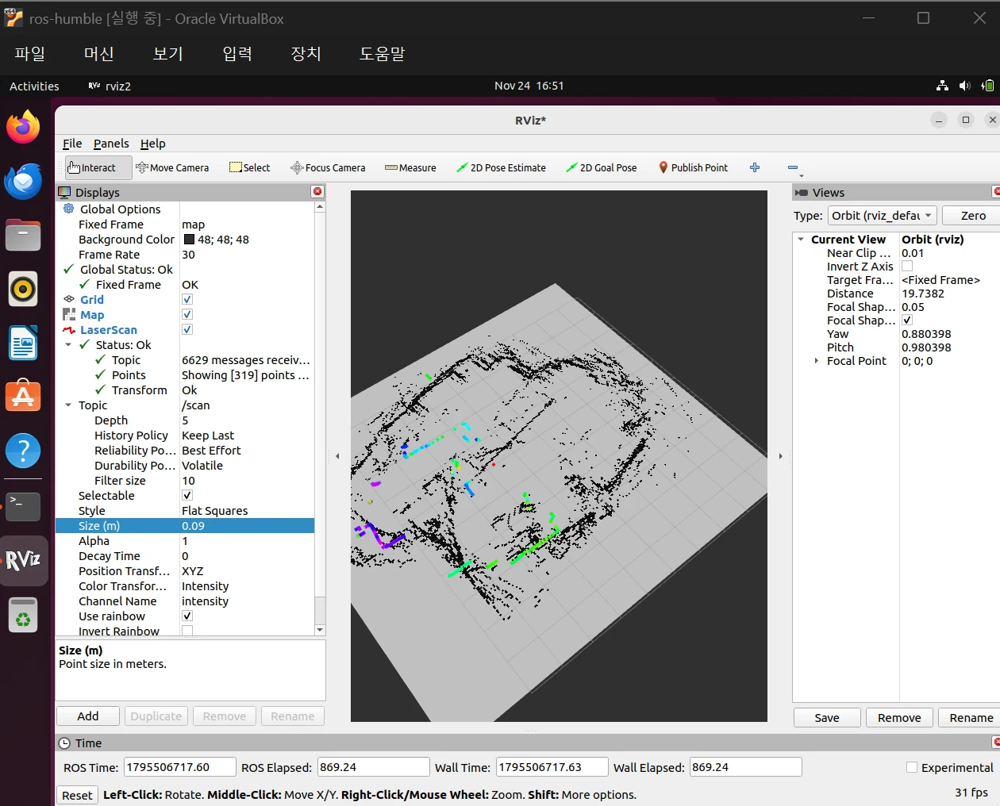
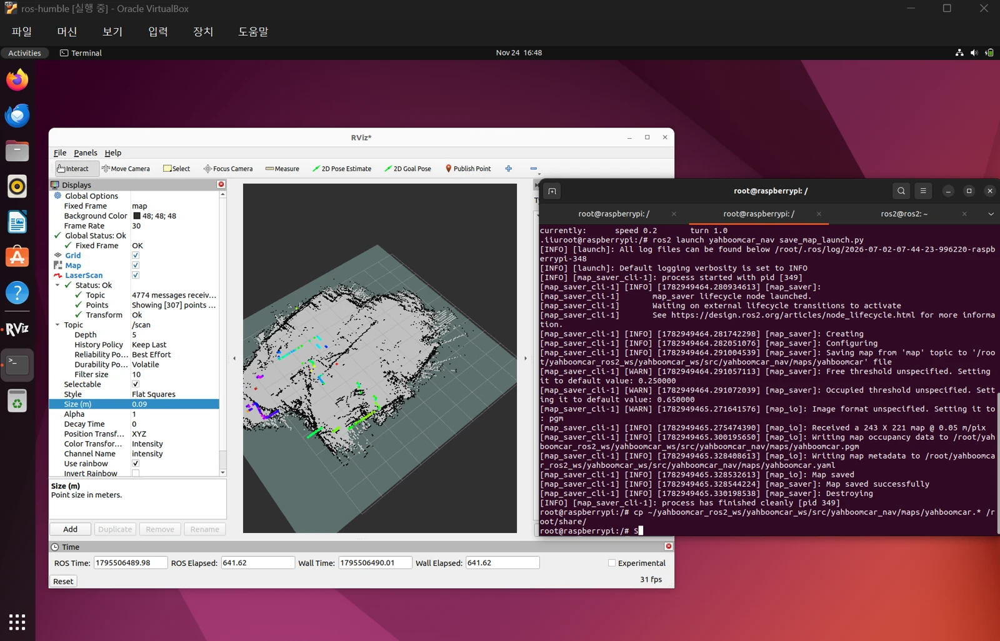
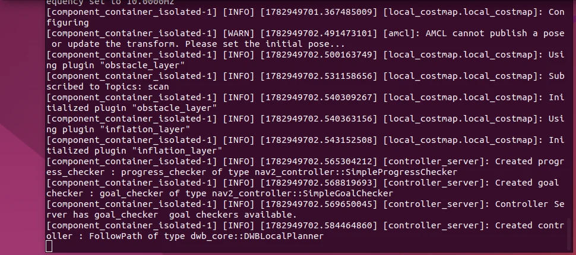
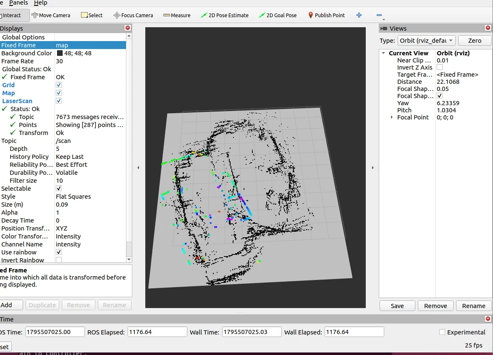
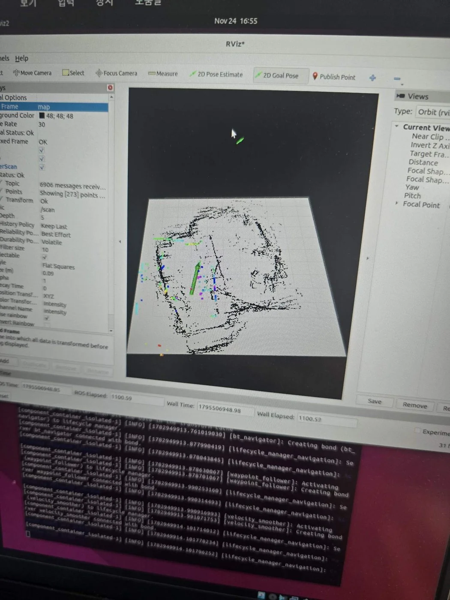

## 들어가며

[2탄](/public/posts/blog-docs/rosmaster-m1-part2-ros2-lidar-slam/)과 [2-fixed탄](/public/posts/blog-docs/rosmaster-m1-part2-fixed-camera-ethernet/)에서 라이다와 카메라를 노트북에서 실시간으로 보는 데까지 왔다. 3탄의 목표는 한 단계 위다.

1. 라이다로 **동아리방 지도를 만들고**
2. 그 지도 위에서 로봇이 **스스로 목표 지점까지 이동**하게 한다

결론부터 말하면 둘 다 됐다. 다만 이번 편의 진짜 수확은 <strong>"직접 몰아서 만드는 방식의 한계"</strong>를 몸으로 안 것이다. 그게 다음 편(자율 탐사)의 출발점이 된다. 각 단계의 실제 영상과 화면도 함께 넣었다.

---

## 1. 지도 만들기 (slam_toolbox)

SLAM은 라이다 스캔(`/scan`)과 바퀴 회전량(오도메트리)으로 지도를 그리면서, 동시에 로봇의 현재 위치를 추정하는 기술이다. 우리는 그래프 최적화 기반의 **slam_toolbox**를 썼다.

### 조종 수단: 게임패드가 막혀서 키보드로

원래 게임패드로 몰려고 했는데, 수신기를 허브에 꽂아도 인식이 안 됐다. 파이 본체에서 `lsusb`를 보니 원인이 보였다.

```text
Bus 003 Device 003: ID 10c4:ea60 Silicon Labs CP210x UART Bridge   # 라이다
Bus 003 Device 002: ID 05a3:9230 ARC International Camera           # 카메라
Bus 001 Device 007: ID 2109:8817 VIA Labs USB Billboard Device     # ← 허브가 협상 실패한 흔적
Bus 001 Device 006: ID 1a86:7523 QinHeng CH340 serial converter    # STM32
Bus 001 Device 003: ID 2109:2817 VIA Labs USB2.0 Hub               # 허브
# 게임패드 수신기와 음성 모듈이 목록에 없음
```

> [!WARNING]
> **시행착오: 허브 전원 부족**
> 게임패드 수신기가 `lsusb`에 아예 안 떴다. 단서는 허브 아래에 뜬 <strong><code>USB Billboard Device</code></strong>였다. 허브 밑 장치가 연결 협상에 실패했을 때 나오는 신호다. 음성 모듈도 같이 사라져 있었다. 라이다·카메라·음성·수신기를 버스 파워 허브 하나에 다 물려서 **전원이 모자란** 것이었다. 전원 공급(셀프 파워) USB 허브가 필요하다. 지도를 만드는 데 게임패드가 꼭 필요한 건 아니라서, 일단 **키보드로** 진행했다.

### 실행

```bash
# 터미널 A (컨테이너): SLAM
sh ~/run_humble.sh
ros2 launch yahboomcar_nav map_slam_toolbox_launch.py

# 터미널 B (컨테이너): 키보드 조종
docker exec -it $(docker ps -q) /bin/bash
source /opt/ros/humble/setup.bash
ros2 run yahboomcar_ctrl yahboom_keyboard
```

노트북 VM에서는 `rviz2`를 띄워 지켜본다. 아래는 키보드로 로봇을 몰면서 지도가 그려지는 것을 확인하는 영상이다.

<video controls playsinline preload="metadata" poster="/assets/video/rosmaster-m1-3/mapping-demo-poster.jpg">
  <source src="/assets/video/rosmaster-m1-3/mapping-demo.mp4" type="video/mp4">
</video>


_키보드로 방을 돌며 지도가 채워지는 중. 라이다 점(컬러)이 벽을 따라 찍힌다_

> [!TIP]
> **시행착오: 라이다 점이 안 보임 (QoS)**
> rviz에 `New publisher on '/scan', offering incompatible QoS ... RELIABILITY` 경고가 뜨면서 라이다 점이 안 나왔다. 라이다는 **Best Effort**로 발행하는데 rviz 기본값이 **Reliable**이라 안 맞은 것이다. 2탄과 똑같은 문제다. LaserScan → Topic → Reliability Policy를 **Best Effort**로 바꾸니 바로 찍혔다.
>
> `active samplers ... GLSL link` 에러도 떴는데, 이건 VM에서 3D 가속이 약해서 나는 **무해한 렌더링 경고**라 무시하면 된다.

### 지도 잘 만드는 법

- **천천히, 회전은 특히 천천히.** 빠르게 돌면 지도가 번진다.
- 벽을 따라 한 바퀴 돌고 **출발점으로 복귀** → slam_toolbox가 누적 오차를 보정한다(루프 클로저).
- 회색(미탐색)으로 남은 곳은 그쪽으로 가서 라이다가 보게 한다.

### 저장

```bash
ros2 launch yahboomcar_nav save_map_launch.py
cp ~/yahboomcar_ros2_ws/yahboomcar_ws/src/yahboomcar_nav/maps/yahboomcar.* /root/share/
```

`243 X 221 map @ 0.05 m/pix`로 저장됐다. `yahboomcar.pgm`(지도 그림)과 `yahboomcar.yaml`(해상도·원점) 두 파일이 생긴다. 파이 컨테이너 안에 저장되므로 `/root/share`(호스트 공유 폴더)로 복사해 백업했다.


_`Map saved successfully`. 243 x 221 지도가 저장되고 공유 폴더로 복사됨_

> [!NOTE]
> 참고: Yahboom ROSMASTER-M1 [11 LiDAR Course의 7. slam_toolbox mapping](https://github.com/YahboomTechnology/ROSMASTER-M1/tree/main/11.LiDAR%20Course), [slam_toolbox GitHub](https://github.com/SteveMacenski/slam_toolbox). 조종은 [06 Chassis Control](https://github.com/YahboomTechnology/ROSMASTER-M1/tree/main/06.Chassis%20Control%20Course). **단, rviz는 로봇이 아니라 노트북 VM에서 띄웠다 (우리 환경 변경점).**

---

## 2. 자율주행 (Nav2)

지도를 만들었으니, 이제 그 지도 위에서 로봇이 스스로 움직이게 한다. Nav2는 지도 로딩(map_server), 위치추정(AMCL), 경로계획(Planner), 추종(Controller), 장애물 회피(Costmap)를 묶은 ROS2의 표준 내비게이션 프레임워크다.

```bash
# 터미널 A (컨테이너): 센서·차체
ros2 launch yahboomcar_nav laser_bringup_launch.py

# 터미널 B (컨테이너): 내비게이션
ros2 launch yahboomcar_nav navigation_dwa_launch.py
```

### 초기 위치 설정

실행하자마자 터미널에 이 로그가 반복됐다.

```text
Timed out waiting for transform from base_footprint to map ... frame "map" does not exist
AMCL cannot publish a pose or update the transform. Please set the initial pose...
```

> [!NOTE]
> **이건 에러가 아니라 정상이다.** AMCL이 "로봇이 지금 어디 있는지 알려달라"고 기다리는 것이다. 초기 위치를 안 정해주면 `map` 좌표계가 안 생겨서 costmap이 계속 투덜댄다. rviz에서 **2D Pose Estimate**로 로봇의 실제 위치를 찍어주면 AMCL이 map→odom 변환을 발행하고, 에러가 멈춘다.


_Nav2 실행 직후의 로그. `AMCL cannot publish a pose`와 함께 costmap(obstacle·inflation), controller_server(DWBLocalPlanner)가 올라온다_

라이다 스캔이 지도 벽과 겹치면 위치추정이 정확한 것이다.


_2D Pose Estimate로 초기 위치를 찍은 뒤, 라이다 점이 지도 벽에 겹친다_

### 목표 지점 주기

그다음 **2D Goal Pose**로 목표 지점을 찍으면 로봇이 경로를 그리고 이동한다. 도착하면 터미널에 `Goal succeeded`가 뜬다.

<video class="narrow" controls playsinline preload="metadata" poster="/assets/video/rosmaster-m1-3/nav2-demo-poster.jpg">
  <source src="/assets/video/rosmaster-m1-3/nav2-demo.mp4" type="video/mp4">
</video>


_2D Goal Pose로 목표(초록 화살표)를 찍는 순간. 아래 터미널에서는 bt_navigator를 비롯한 Nav2 노드들이 동작 중이다_

### 수동 매핑의 한계가 드러나다

여기서 문제가 보였다. **목표를 줄 때마다 성공(succeed)과 실패(fail)가 갈렸다.** 벽에서 떨어진 빈 공간을 찍으면 잘 갔지만, 벽 근처나 회색(미탐색) 영역을 찍으면 경로계획이 실패했다.

원인은 로봇이 아니라 **지도 품질**이었다. 수동으로 빠르게 몰아서 만든 지도는 벽이 살짝 겹치거나 번져 있고, 그 위에 costmap을 깔면 없는 장애물이 생기거나 통로가 막힌 것처럼 보인다. 바닥(지도)이 울퉁불퉁하니 그 위의 자율주행도 흔들린 것이다.

---

## 3. 그래서 다음은, 자율 탐사

손으로 모는 매핑은 두 가지가 불편했다.

- **번거롭다.** 사람이 로봇을 따라다니며 구석구석 몰아야 한다.
- **품질이 들쭉날쭉하다.** 속도·회전에 따라 지도가 번지고, 그게 Nav2 실패로 이어진다.

그래서 다음 편의 방향을 <strong>자율 탐사(frontier exploration)</strong>로 잡았다. 로봇이 스스로 "아직 안 본 경계"를 찾아가며 지도를 실시간으로 채우는 방식이다. 여기엔 로봇의 WiFi(AP) 너머로 지도를 끊김 없이 모니터링하는 **네트워크 튜닝** 문제도 함께 걸려 있어서, 그 둘을 4탄에서 다룬다.

> [!DANGER]
> **복선: 공격면 메모**
> 지도를 만들며 `ros2 topic list`를 보다가 알게 된 것이 있다. `/cmd_vel`, `/Buzzer`, `/RGBLight`, `/Servo`는 ROS2 토픽이지만 **음성 모듈과 CPU/RAM 화면은 토픽이 아니다.** 음성은 USB 오디오, 화면은 STM32 시리얼로 그려진다. 같은 네트워크에서 `ROS_DOMAIN_ID`만 맞추면 이 토픽들에 누구나 발행할 수 있다는 건 2탄에서 확인했다. 이게 뒤쪽 보안 편에서 직접 다룰 공격면이다.

---

## 시행착오 요약

| 증상 | 원인 | 해결 |
| --- | --- | --- |
| 게임패드 수신기 미인식 | 허브 전원 부족 (Billboard Device, 음성모듈도 누락) | 키보드로 매핑, 전원 공급 허브 필요 |
| rviz에 라이다 점 안 보임 | `/scan` QoS Reliable vs Best Effort | rviz LaserScan을 Best Effort로 |
| `GLSL link / active samplers` 에러 | VM 3D 가속 약함 | 무해, 무시 |
| `map frame does not exist` 반복 | AMCL 초기 위치 미설정 | 2D Pose Estimate로 위치 지정 |
| Nav2 목표 실패/성공 반복 | 수동 지도 품질(벽 번짐) | 빈 공간에 목표, 또는 지도 재제작 → 자율 탐사로 |

## 출처

- Yahboom ROSMASTER-M1 [11 LiDAR Course](https://github.com/YahboomTechnology/ROSMASTER-M1/tree/main/11.LiDAR%20Course): 7. slam_toolbox mapping, 8. Navigation2
- Yahboom ROSMASTER-M1 [06 Chassis Control Course](https://github.com/YahboomTechnology/ROSMASTER-M1/tree/main/06.Chassis%20Control%20Course): 키보드 조종
- Yahboom ROSMASTER-M1 [21 ROS2 basic course](https://github.com/YahboomTechnology/ROSMASTER-M1/tree/main/21.ROS2%20basic%20course): 17. rviz2 use
- [slam_toolbox](https://github.com/SteveMacenski/slam_toolbox), [Nav2 공식 문서](https://navigation.ros.org/)
- 우리 환경 변경점: rviz는 노트북 VM에서 실행, 연결은 [2-fixed탄](/public/posts/blog-docs/rosmaster-m1-part2-fixed-camera-ethernet/)의 랜선 직결/WiFi 구성 사용

## 다음 편 예고

- 로봇이 혼자 돌아다니며 지도를 완성하는 **자율 탐사(frontier exploration)**
- 로봇 WiFi(AP) 너머로 끊김 없이 모니터링하는 **DDS·네트워크 튜닝**
- 그리고 이렇게 완성한 "스스로 움직이는 로봇"을, 다음 보안 편에서 직접 공격해본다
