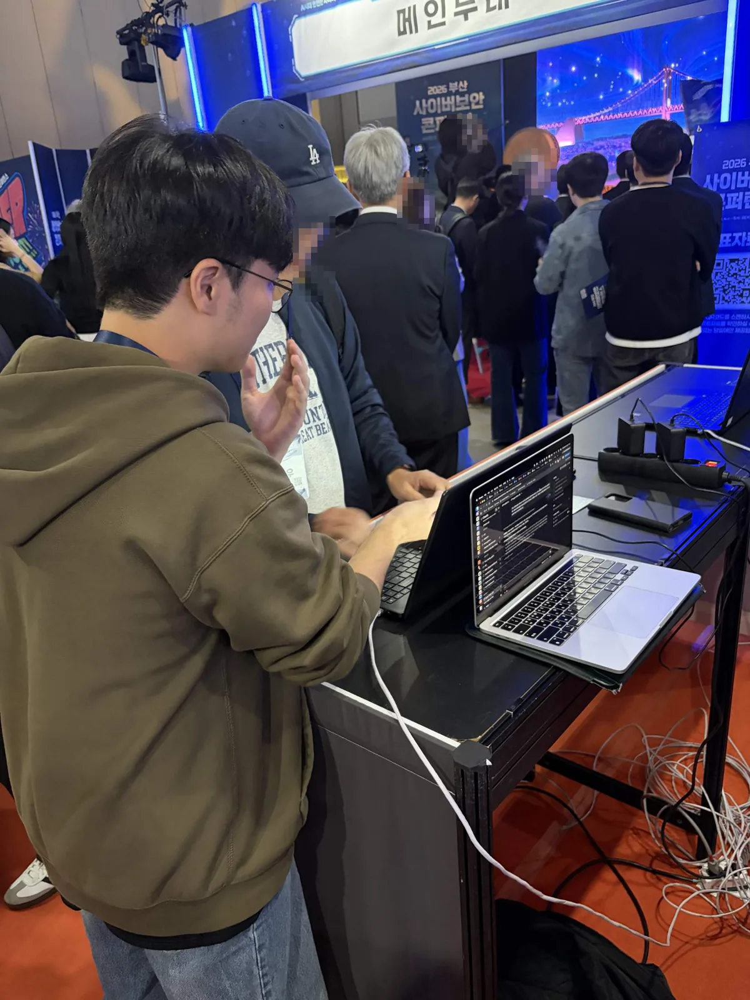

코드게이트에서 운영했던 체험 프로그램을 인스타그램으로 보신 분께 연락을 받았고, 그 인연으로 2026 부산 사이버보안 콘퍼런스에서 부스를 운영하게 되었다.

_벡스코 부스 앞에서 운영진과 함께_

## 시큐어 바이브 코딩

우리가 맡은 부스는 AI·보안체험 구역의 "시큐어 바이브 코딩"이었다. 진행 방식은 단순하다.

1. 원하는 개발 과제를 고르고 프롬프트를 직접 입력한다
2. AI가 생성한 코드의 보안 취약점을 자동으로 분석한다
3. 분석으로 나온 보안 점수를 확인한다

프롬프트 한 번으로 얼마나 안전한 코드를 받아낼 수 있는지 도전해 보는 체험이다.

_메인 무대 바로 옆이라 오가는 분이 많았다_

중간중간 다른 기관 부스도 둘러봤다.

_HUG 주택도시보증공사 부스에서_

## 부산에서 2박 3일

부산은 몇 번 가 본 적이 없어서, 이번에 벡스코가 얼마나 큰지 제대로 체감했다. 해운대도 이번에 처음 가 봤다.

2박 3일 동안 부산에 머물면서 팀원들과 맛있는 야식도 먹었다. 하루 일정을 마치고 다 같이 모여 앉아 먹은 그 시간이 행사만큼이나 기억에 남는다.

_팀원들과 먹은 야식_

부스를 찾아 주신 분들과, 사흘 동안 같이 고생한 팀원들에게 고맙다.
