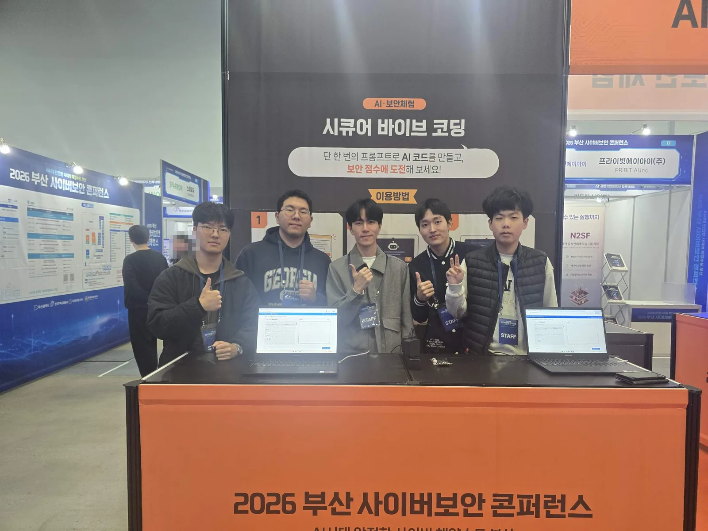
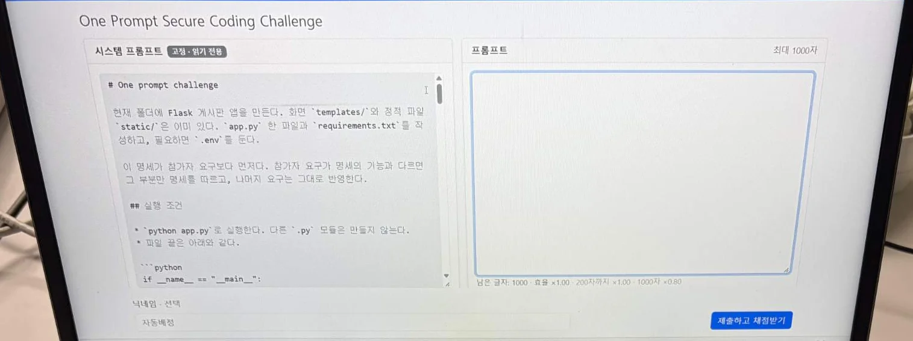
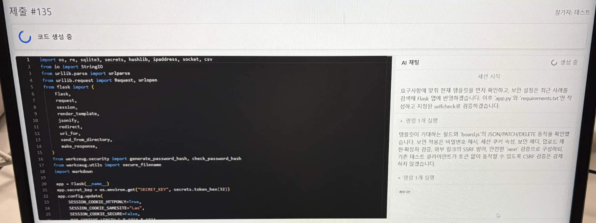
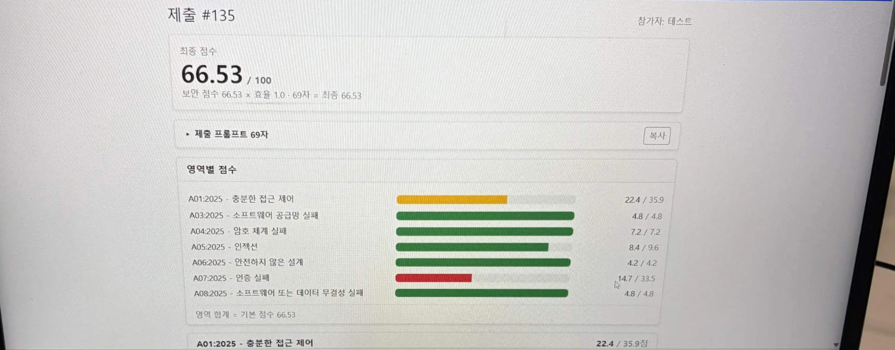
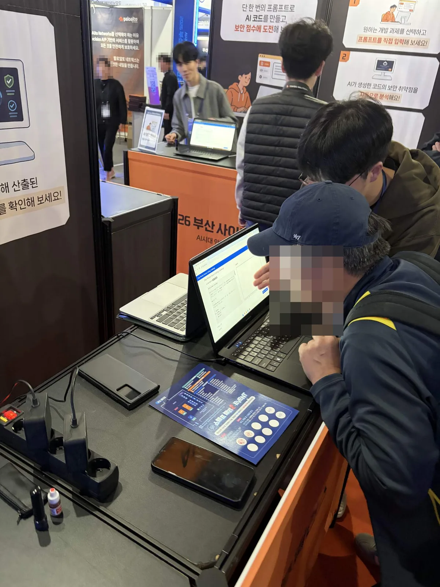
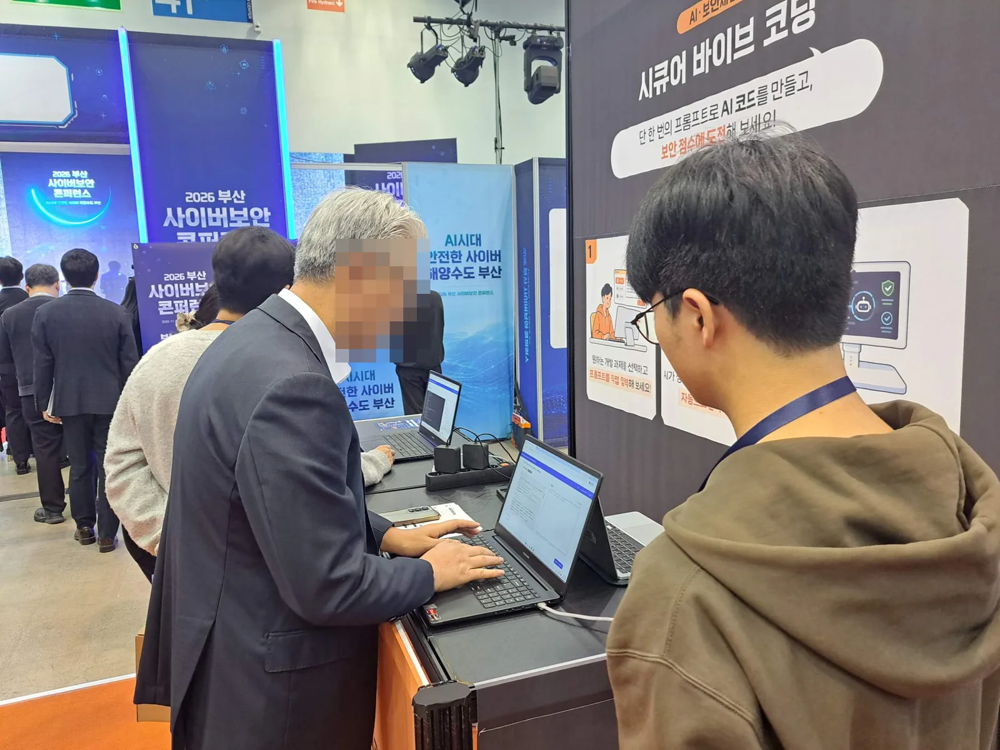
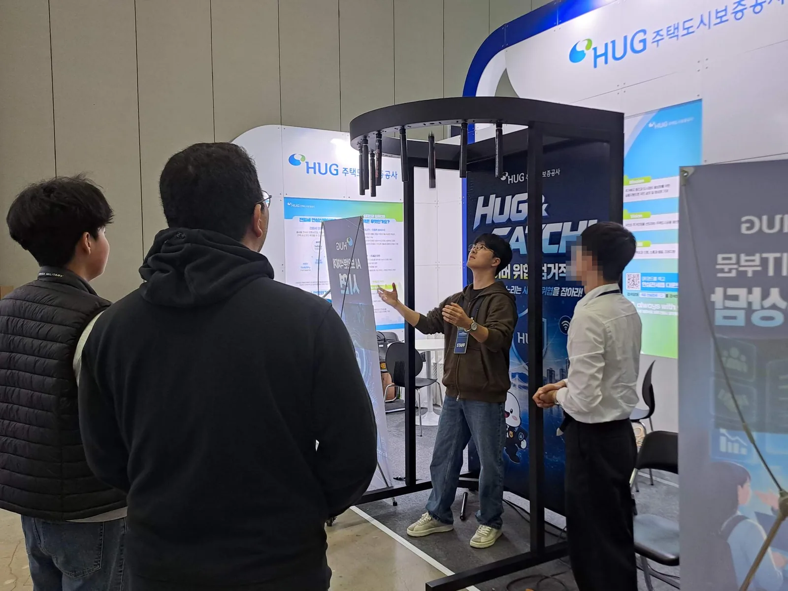
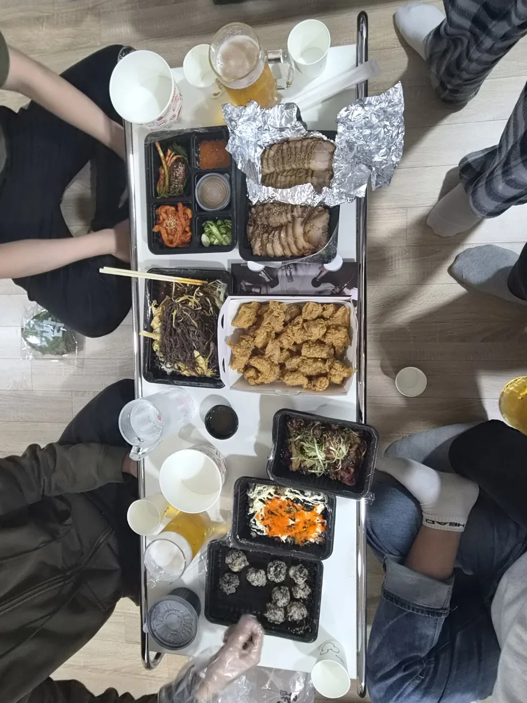

코드게이트에서 운영했던 체험 프로그램을 인스타그램으로 보신 분께 연락을 받았고, 그 인연으로 2026 부산 사이버보안 콘퍼런스에서 부스를 운영하게 되었다. 행사는 11월 4일부터 5일까지 이틀 동안 벡스코에서 열렸다.

_벡스코 부스 앞에서 운영진과 함께_

## 시큐어 바이브 코딩

우리가 맡은 부스는 AI·보안체험 구역의 "시큐어 바이브 코딩"이었다.

지금은 바이브 코딩의 시대이다. 1인 개발자나 프리랜서는 물론이고 기업에서도, AI에게 코드를 맡기면서 시큐어 코딩보다 "일단 돌아가는 기능"에만 집중하는 경우가 있다. 이 부분에 경각심을 주고 싶어서 **One Prompt Secure Coding Challenge**라는 체험을 준비했다.

방식은 이렇다.

1. Flask로 게시판을 만드는 기능 명세는 시스템 프롬프트로 이미 고정되어 있다
2. 참가자는 여기에 보안을 챙기기 위한 프롬프트를 **딱 한 번** 입력한다
3. AI가 그 프롬프트로 코드를 생성하고, 생성된 코드의 보안 취약점을 자동으로 분석해 점수를 매긴다

_왼쪽의 기능 명세는 고정이고, 참가자는 오른쪽에 프롬프트를 한 번만 쓴다. 프롬프트가 길어질수록 효율 배수가 깎인다_

_제출하면 AI가 코드를 만드는 과정을 그대로 볼 수 있다_

점수는 OWASP Top 10 항목별로 나뉘어 나온다. 어느 영역에서 점수를 잃었는지 바로 보이고, 생성된 게시판 사이트에 직접 들어가서 어떤 보안 문제가 남아 있는지 확인해 볼 수도 있다.

_테스트로 넣어 본 69자짜리 프롬프트의 결과. 접근 제어와 인증에서 점수가 많이 빠졌다_

기능만 요청해도 동작하는 게시판은 나온다. 하지만 보안을 어떻게 요구하느냐에 따라 결과물이 얼마나 달라지는지를 점수로 직접 보게 하는 것이 이 체험의 목적이었다.

_메인 무대 바로 옆이라 오가는 분이 많았다_

중간중간 다른 기관 부스도 둘러봤다.

_HUG 주택도시보증공사 부스에서_

## 부산에서 2박 3일

부산은 몇 번 가 본 적이 없어서, 이번에 벡스코가 얼마나 큰지 제대로 체감했다. 해운대도 이번에 처음 가 봤다.

2박 3일 동안 부산에 머물면서 팀원들과 맛있는 야식도 먹었다. 하루 일정을 마치고 다 같이 모여 앉아 먹은 그 시간이 행사만큼이나 기억에 남는다.

_팀원들과 먹은 야식_

부스를 찾아 주신 분들과, 사흘 동안 같이 고생한 팀원들에게 고맙다.
