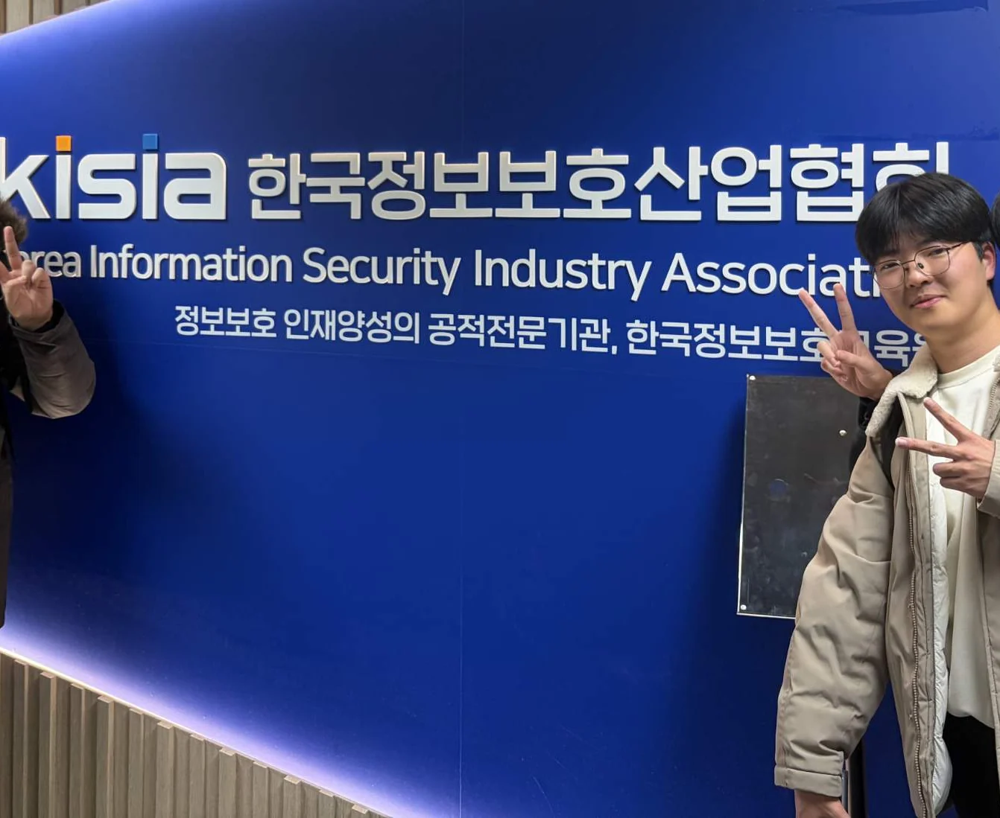

2026년 11월 26일, KUCIS 활동으로 동아리 프로젝트를 발표하러 한국정보보호산업협회(KISIA)에 다녀왔다. 2026 KUCIS 우수동아리 발표평가 자리였고, 내가 발표자로 나서고 동아리 선배 두 분과 함께 갔다. 우리 동아리 APS가 한 해 동안 진행한 프로젝트인 **OpenStack 기반 동아리 클라우드 구축 및 CSPM 구현**을 발표했다.

_KISIA 로고 앞에서_

발표 자료와 발표 내용 정리, 후기는 따로 정리해 두었다.
