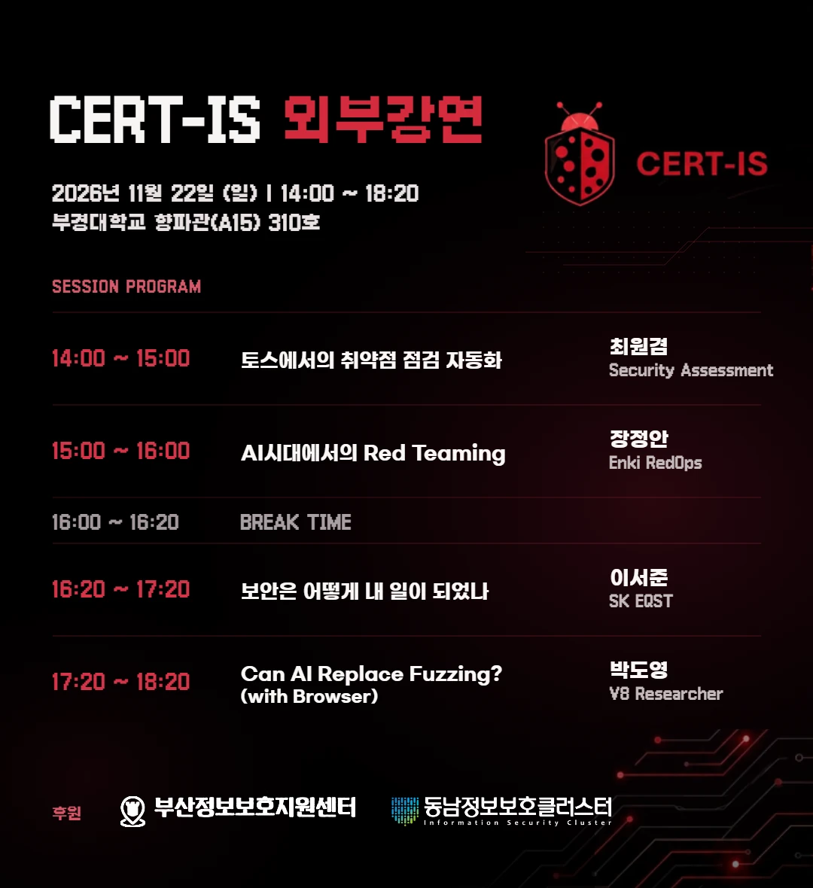

2026년 11월 22일, 부경대학교 정보보호 동아리 CERT-IS가 연 외부강연에 다녀왔다. 향파관에서 오후 2시부터 네 시간 남짓, 현직자 네 분의 발표를 들었다.

_CERT-IS 외부강연 포스터_

## 들은 세션

| 주제 | 연사 |
| --- | --- |
| 토스에서의 취약점 점검 자동화 | 최원겸 (Security Assessment) |
| AI시대에서의 Red Teaming | 장정안 (Enki RedOps) |
| 보안은 어떻게 내 일이 되었나 | 이서준 (SK EQST) |
| Can AI Replace Fuzzing? (with Browser) | 박도영 (V8 Researcher) |

취약점 점검 자동화, AI 시대의 레드팀, 커리어 이야기, 브라우저 퍼징까지 네 세션을 모두 들었다. 세션별로 받아 적은 내용은 따로 정리해 두었다.
