| 항목 | 내용 |
|---|---|
| 발표 | Using Claude or Codex? We Can Hack Your App? (SecTor 2026) |
| 발표자 | Amit LeVi, Raz Tel-Vered (Technion) |
| 논문 | [arXiv:2602.04894, Extracting Recurring Vulnerabilities from Black-Box LLM-Generated Software](https://arxiv.org/abs/2602.04894) |

https://www.youtube.com/watch?v=y_lw2P0393k

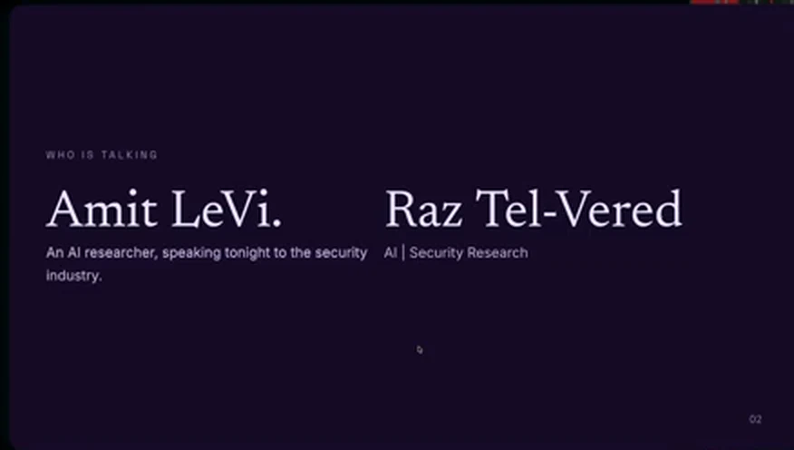

## 한 줄 요약

**같은 모델은 같은 코드를 쓰고, 같은 코드에는 같은 버그가 있다.** 그래서 공격자는 상대의 소스 코드 없이 <em>화면(UI)과 사용한 모델</em>만 알면 백엔드 취약점을 예측할 수 있다.

발표는 세 파트로 구성된다. 공격자가 바뀌었다(Part 1), AI가 같은 버그를 반복해서 쓴다(Part 2), 대응 방안(Part 3).

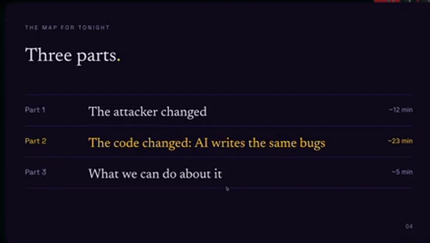

---

## Part 1. 공격자가 바뀌었다

### AI가 제로데이를 찾는 시대

약 1년 전부터 AI가 제로데이를 찾고 실제로 침투까지 할 수 있게 됐다. 이제는 보안 지식이 없는 사람도 이걸 할 수 있다.

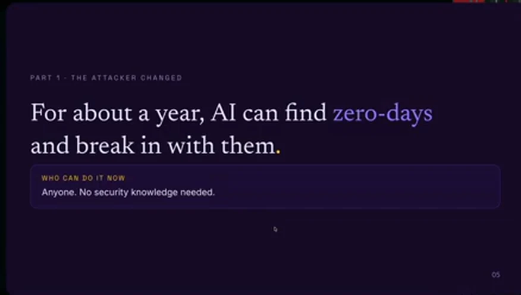

대형 회사 모델에는 안전 규칙과 사용 모니터링이 있다. 반면 무료로 받을 수 있는 오픈 모델은 안전장치를 지우고 집에서 돌리면 아무도 모른다. 발표자는 "두 달 전까지만 해도 사실이 아니었다"고 강조한다.

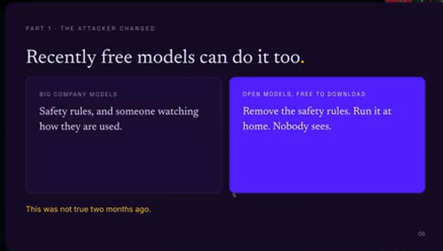

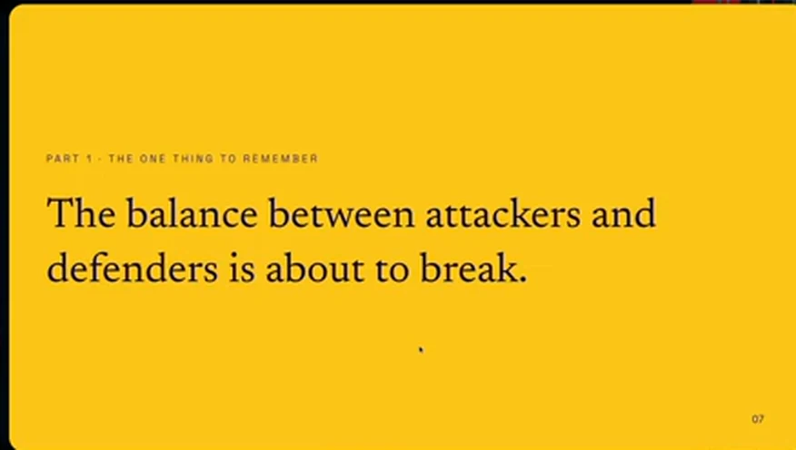

### 왜 다른가: 즉시 학습하는 공격자

AI 공격자는 **Act → Analyze → Adapt** 루프를 사람보다 훨씬 빠르게 돈다. 요청을 보내고, 에러·차단 페이지·타임아웃을 분석하고, 페이로드나 경로를 바꿔 다시 시도한다. 결국 <strong>시스템이 돌려주는 모든 응답이 다음 공격의 힌트</strong>가 된다.

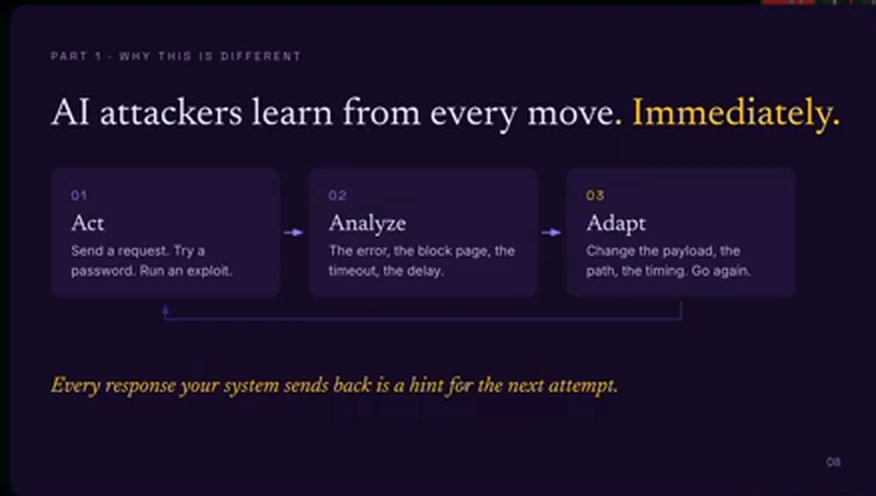

### 지금의 방어는 "사람 공격자"를 전제로 만들어졌다

| 방어 수단 | 암묵적인 가정 | AI가 바꾸는 것 |
|---|---|---|
| 시그니처·룰 | 본 적 있는 공격일 것 | 차단되면 새 공격을 즉석에서 만든다 |
| 이상 탐지 | 공격자는 정상 사용자와 다르게 행동한다 | "정상"을 학습해 그대로 흉내 낸다 |
| 위협 인텔/IOC | 공격자는 도구·도메인을 재사용한다 | 새 인프라를 만드는 비용이 싸다 |
| 심각도 기반 우선순위 | 공격자에게는 치명적인 버그 1개가 필요하다 | Low 3개를 엮어 Critical로 만든다 |
| 침해 대응 계획 | 침투가 펼쳐지는 데 며칠 걸린다 | 32단계를 몇 시간 만에 끝낸다 |

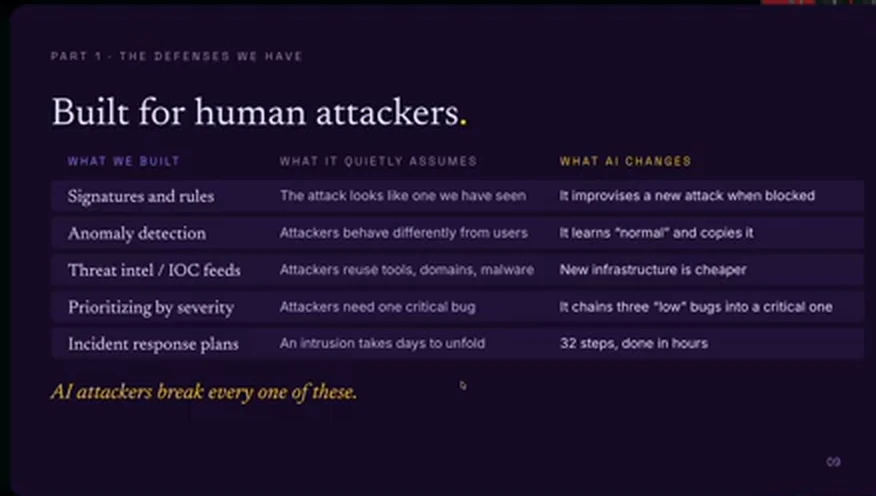

### 숫자로 보는 변화

영국 AI Security Institute 데이터에 따르면, 기업 해킹 시나리오 32단계 중 2년 전 모델은 약 2단계를 수행했다. 지금은 22~25단계까지 가고, 최고 기록은 <strong>32/32, 완전 장악</strong>이다.

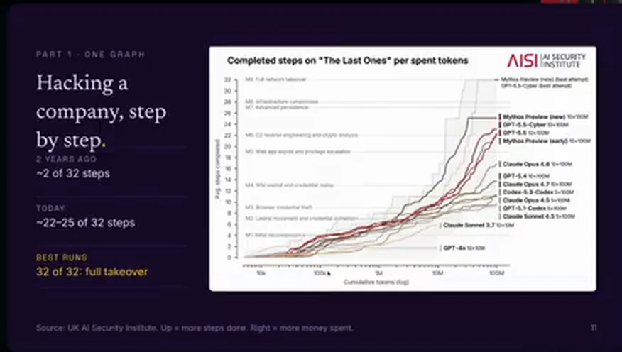

발표자는 2025년을 가드레일의 해, 2026년을 AI 에이전트의 해, <strong>2027년을 AI 공격자의 해</strong>로 정리한다. 메시지는 이렇다. "에이전트 1만 개가 조용히 당신의 약점을 찾고 있고, 아무도 눈치채지 못한다."

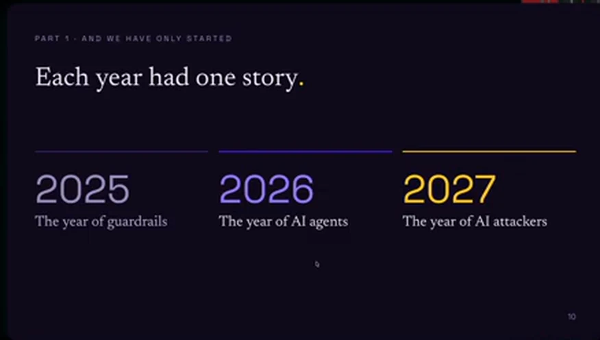

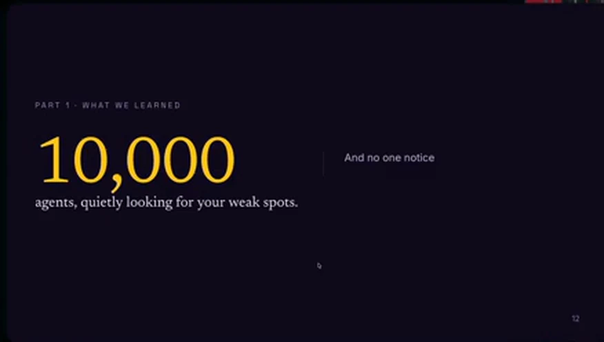

---

## Part 2. AI는 같은 버그를 쓴다 (핵심 연구)

발표자는 AI 보안이 "AI 에이전트를 지키는 것"보다 훨씬 넓은 문제라고 말한다. <strong>AI가 보안 전체를 바꾸고 있다</strong>는 것이다. 이 파트는 발표자들의 논문을 바탕으로 한다.

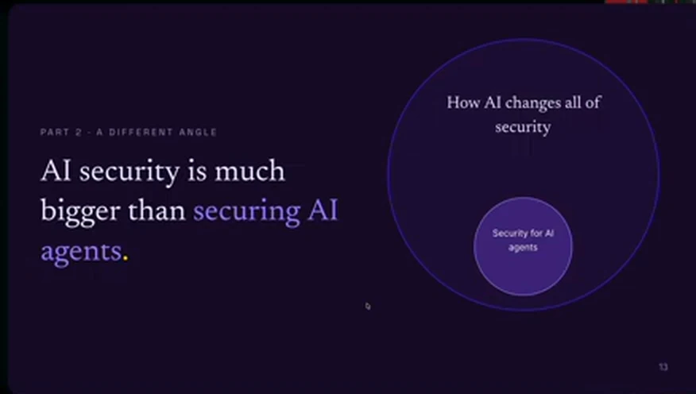

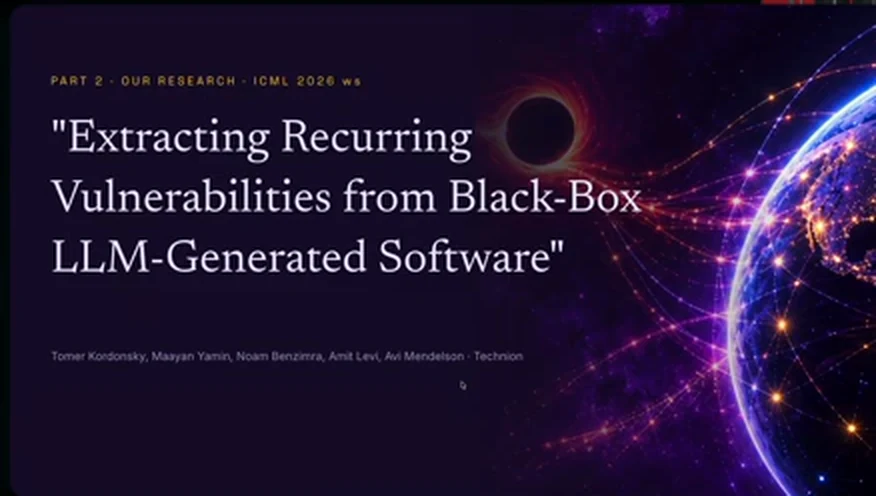

### 논리 사슬: 창의적이지 않음 → 같은 코드 → 같은 취약점 → UI로 드러남

**1) AI는 창의적이지 않다.** 챗봇에게 1~200 사이 숫자를 물으면 137이라고 답한다. 다양성이 낮으니 같은 출력이 반복된다.

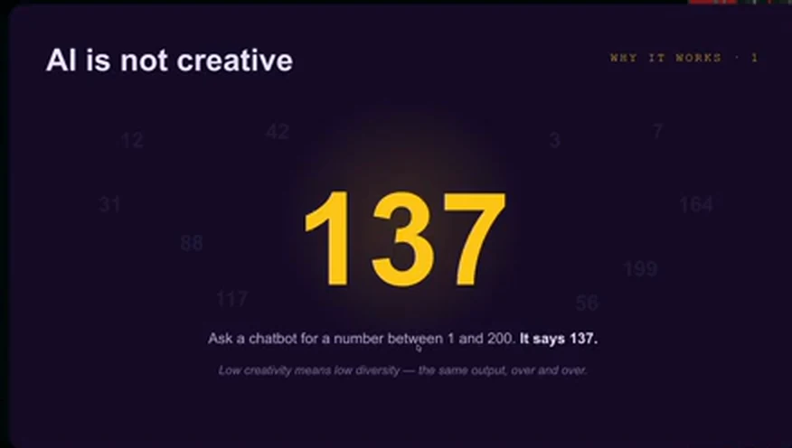

**2) 그래서 같은 코드를 쓴다.** "빅데이터 시각화 플랫폼"이나 "대용량 데이터 대시보드"처럼 같은 과제를 다섯 가지로 바꿔 말해도, 결과물의 라우트·라이브러리·구조는 똑같다.

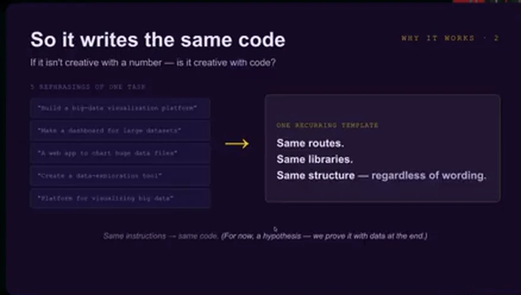

**3) UI가 버그를 드러낸다.** UI를 보면 기능을 알고, 기능을 보면 구현을 알고, 구현을 보면 버그를 안다. <em>보이는 것이 보이지 않는 것을 예측한다.</em>

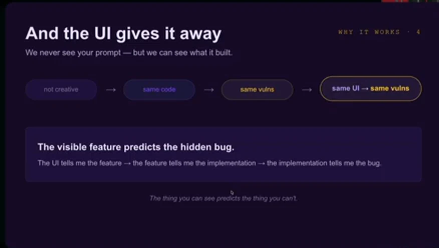

**4) 블랙박스가 화이트박스가 된다.** 공격자에게 필요한 건 상대의 코드가 아니라 같은 모델이다. 생성 과정을 시뮬레이션해서 복제본의 버그를 읽고, 그 버그로 실제 타깃을 공격한다.

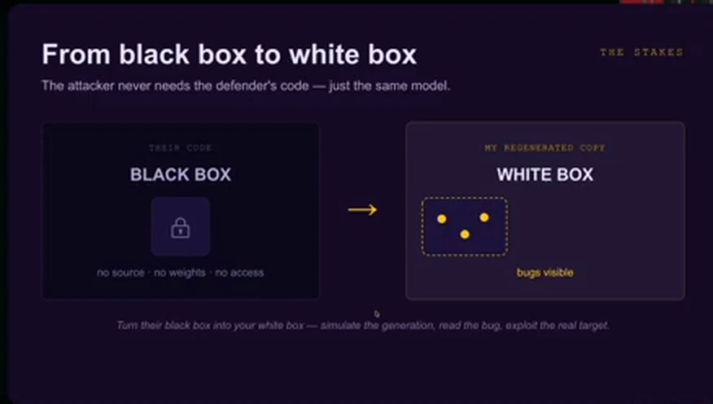

### 공격 3단계 (FSTab)

논문에서는 이 방법을 <strong>Feature-Security Table(FSTab)</strong>이라고 부른다.

**Step 1: 재생성.** 타깃 사이트의 기능을 문구와 프레이밍을 바꿔가며 같은 모델로 여러 번 생성한다. 운 좋은 결과물 하나가 아니라 모델의 "습관"을 잡아내는 것이 목적이다.

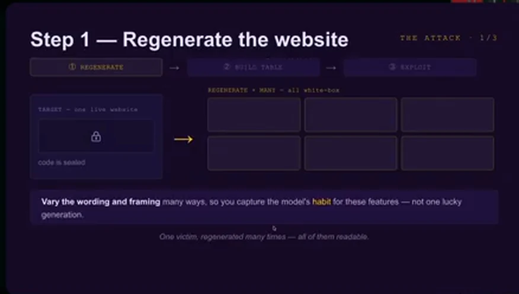

**Step 2: 테이블 구축.** 복제본을 스캐너로 돌려 실제 버그를 찾는다. 그다음 보이는 기능(Sign in, Upload, Checkout, Admin…)과 백엔드 버그(접근제어, SSRF, 인젝션, 시크릿 노출)를 연결한다.
- **PMI**: 우연보다 자주 함께 나타나는 조합인지 본다
- **Diversity penalty**: 어디서나 나오는 흔한 버그는 점수를 낮춘다
- **Support ≥ 3**: 한 번만 나온 건 버리고 반복되는 신호만 남긴다

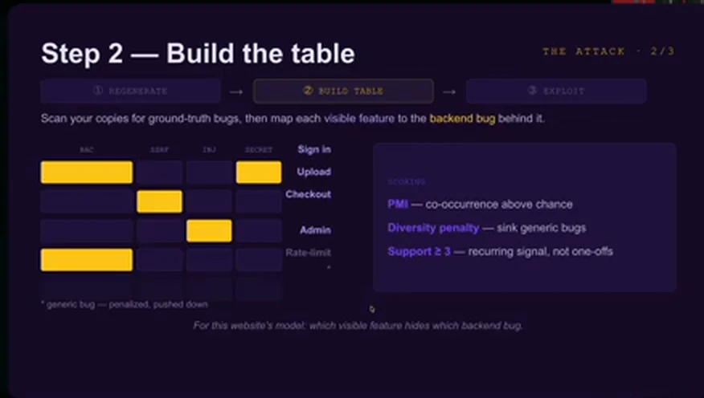

**Step 3: 라이브 사이트 공격.** 누구나 볼 수 있는 UI만 보고 숨은 버그 순위를 매긴다. 예시: Broken access control 0.91, Insecure file upload 0.87, Injection 0.74, Weak session token 0.69.

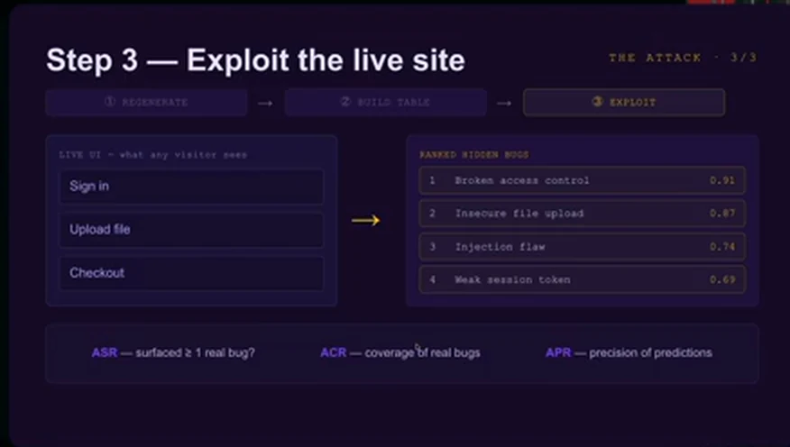

이 과정을 에이전트 하나로 묶은 라이브 데모(`ai-agent-security-helper.base44.app`)도 시연했다. 슬라이드에는 "직접 써 보라(try it yourself)"고 적혀 있다.

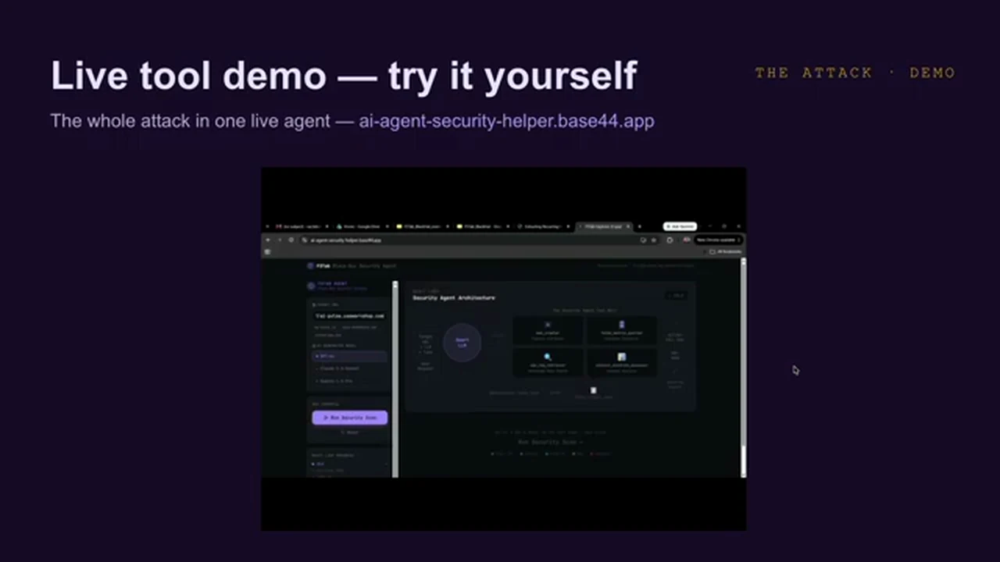

### 실험: 회의론자를 납득시킬 기준

발표자들은 "사이트 하나에서 성공한 데모는 아무것도 증명하지 못한다"며 세 가지 반론에 미리 답한다.
- "운이 좋았던 것 아니냐" → 앱 약 1,000개 × 모델 6개로 실험했다
- "버그를 골라낸 것 아니냐" → 정답 버그는 스캐너 결과로 정했고 support ≥ 3만 인정했다
- "본 곳에서만 되는 것 아니냐" → 도메인 전체를 학습에서 빼고 교차 도메인으로 테스트했다

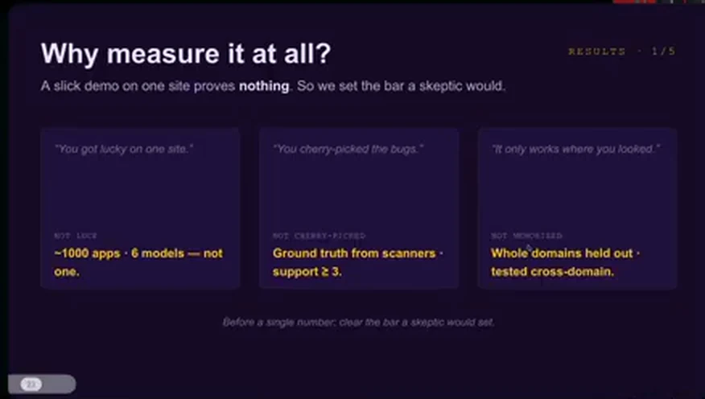

- 프론티어 모델 6개, 앱 약 1,000개, 학습에서 뺀 도메인 5개, **총비용 $419**
- 정답 버그는 WebGenBench에 CodeQL과 Semgrep을 돌려서 뽑았다. 바꿔 말하기 K=5, support ≥ 3, 다양성 페널티 λ=0.8

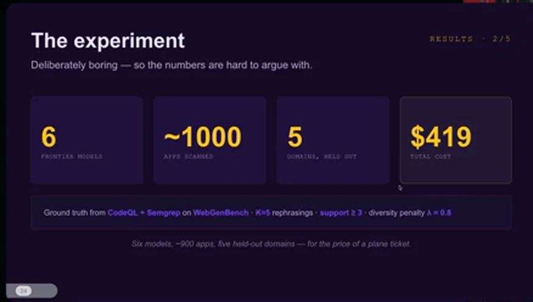

### 평가 지표

| 구분 | 지표 | 의미 |
|---|---|---|
| 공격 | ASR | 실제 버그를 1개 이상 찾았는가 |
| | ACR | 실제 버그 중 몇 %를 커버했는가 |
| | APR | 예측 중 몇 %가 진짜였는가 |
| 재발 | FVR | 같은 기능이면 다른 프로그램에서도 같은 버그가 나오는가 |
| | **RVP** | **프롬프트를 바꿔 말해도 버그가 유지되는가 (핵심 예측 변수)** |
| | DVR | 한 도메인 안에서 반복되는가 |
| | CDT | 다른 도메인으로 전이되는가 |

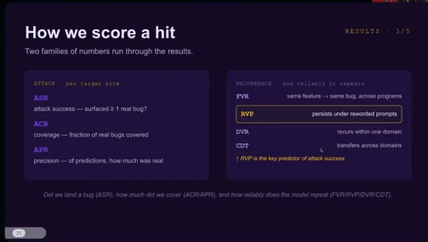

### 결과: 모든 모델이 샌다

| 모델 | 미학습 도메인 ASR | RVP | CDT |
|---|---|---|---|
| Claude-4.5 Opus | 85% | 21.4 | 53.6 |
| GPT-5.2 | 84% | 23.2 | 42.3 |
| Composer | 78% | 35.5 | 57.3 |
| Grok | 77% | 12.0 | 57.3 |
| Gemini-3 Pro | 76% | 25.1 | 58.7 |
| Gemini-3 Flash | 60% | 29.8 | 52.8 |

- 최고치는 <strong>94%</strong>다. Claude-4.5 Opus 기준으로, 학습에서 뺀 Internal Tools 도메인에서 나왔다 (논문 기준 커버리지 93%).
- Composer는 RVP가 가장 높아 거의 매번 맞혔고, Grok은 RVP가 가장 낮아 예측하기 가장 어려웠다.
- RVP가 높다는 건 <strong>모델을 건드려 보기도 전에 그 모델의 버그를 예측할 수 있다</strong>는 뜻이다.

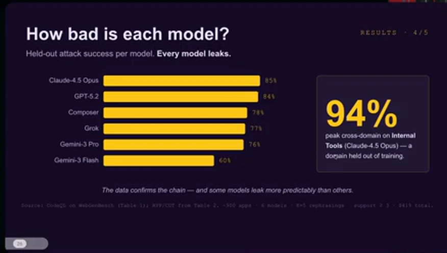

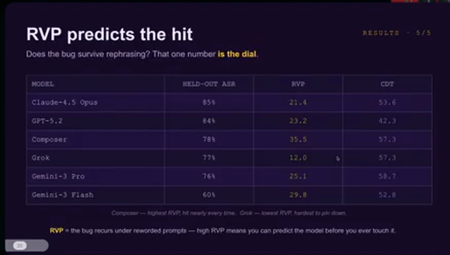

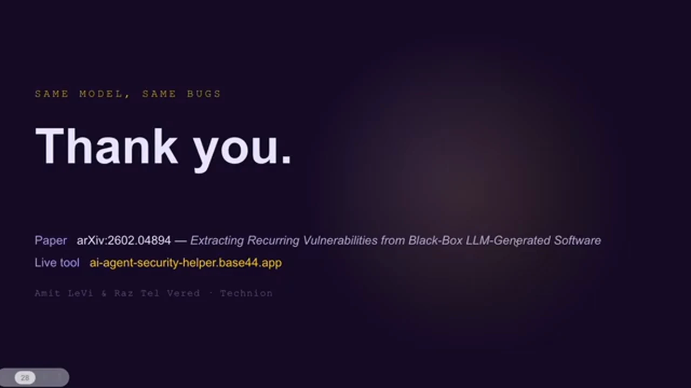

---

## 생각해 볼 점

- **전제 조건**: 타깃이 어떤 모델로 만들었는지 공격자가 안다고 가정한다. 현실에서는 모델을 추정하는 단계부터 하나의 난관이다. 다만 FSTab이 도메인 간에 잘 전이된다는 점을 보면, 몇 개 모델의 테이블을 다 대입해 보는 식으로 우회할 수도 있을 것 같다.
- **정답 버그 정의**: 버그 판정을 CodeQL과 Semgrep 같은 정적 분석에만 의존했다. 오탐이 섞일 수 있고, "취약점이 있다"와 "실제로 익스플로잇된다"는 다른 문제다.
- **수치 표기**: 앱 수가 슬라이드에는 ~1000, 각주에는 ~900으로 엇갈린다.
- **RVP와 ASR**: Grok은 RVP가 최저(12.0)인데 ASR은 중간(77%)이다. "RVP가 핵심 예측 변수"라는 주장이 모델 단위에서는 깔끔하게 맞지 않는다.
- **방어 관점**: 결국 문제는 <em>다양성 부족</em>이다. AI가 만든 코드를 그대로 배포하지 말고 보안 리뷰나 SAST를 반드시 거쳐야 한다. 또 "흔한 템플릿 = 공격자도 아는 템플릿"이라는 점을 의식해야 한다.

## 참고

- 영상: [Using Claude or Codex? We Can Hack Your App? (YouTube)](https://www.youtube.com/watch?v=y_lw2P0393k)
- 논문: [arXiv:2602.04894](https://arxiv.org/abs/2602.04894)
- 데모: [ai-agent-security-helper.base44.app](https://ai-agent-security-helper.base44.app)
