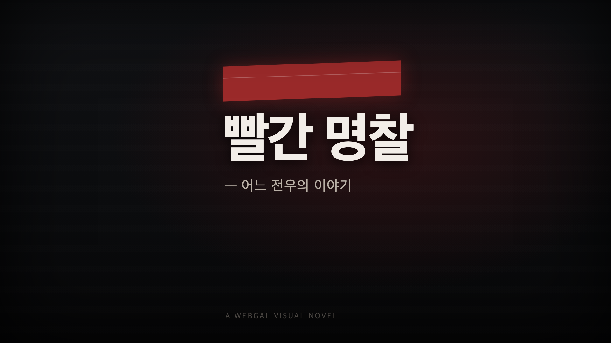

> [!WARNING]
> 이 게임은 군대 내 가혹행위와 그로 인한 죽음을 다룬다. 자해나 자살을 직접 묘사하지 않지만 그 암시가 있다. '만약'을 가정한 허구이며 특정 부대나 인물의 실제 사건이 아니다.
> 힘든 상황에 있다면 혼자 견디지 말자. 국방헬프콜 1303 (24시간) · 자살예방상담 109



## 게임 정보

- 제목: **빨간 명찰 — 어느 전우의 이야기**
- 장르: 분기형 비주얼 노벨
- 플레이: [plyegh.github.io/yu/seon/ho/game/play/](/yu/seon/ho/game/play/) (설치 없이 브라우저에서 실행)
- 엔진: WebGAL 4.6.4
- 분량: 장면 파일 28개, 스크립트 약 1,200줄
- 엔딩: 20개 (BAD 15 · HAPPY 4 · TRUE 1)
- 첫 공개: 2026.09.23

## 한 줄 요약

같은 날 정문을 넘은 동기 유선호가 선임의 표적이 된다. 옆자리의 '나'가 무엇을 하느냐에 따라 결말이 스무 가지로 갈라진다.

## 1. 플레이 방법

1. 위 링크로 들어가면 안내 문구가 먼저 나온다. 화면을 누르면 타이틀로 넘어간다.
2. 화면을 누르거나 Enter, Space를 누르면 대사가 넘어간다.
3. 선택지가 나오면 하나를 고른다. 한 번 플레이에 7~8번 고르게 된다.
4. 엔딩 화면에 `엔딩 수집 n / 20`이 표시된다. 수집 현황은 브라우저에 저장된다.
5. 본 엔딩은 타이틀의 감상 메뉴에서 다시 볼 수 있다.

PC와 모바일 모두 된다. 모바일은 가로 화면이 보기 편하다. 저장, 불러오기, 자동 진행, 대사 기록은 WebGAL 기본 메뉴를 그대로 쓴다.

> [!TIP]
> BAD 엔딩마다 마지막에 한 줄짜리 힌트가 나온다. 어디서 다르게 골랐어야 했는지를 알려 주는 문장이라, 다음 회차의 길잡이가 된다.

## 2. 이야기 구조

| 구간 | 제목 | 선택지 |
| --- | --- | --- |
| 프롤로그 | 같은 날 정문을 넘었다 | 1 |
| 제1막 | 괜찮다는 말 | 2 |
| 제2막 | 계단 | 1 (길 고르기) |
| 제2막 이후 | 네 갈래 중 하나 | 3~4 |

제2막에서 길이 넷으로 갈라진다.

| 길 | 고르는 선택지 |
| --- | --- |
| 침묵 | 모른 척한다 |
| 간부 | 간부에게 보고한다 |
| 증거 | 증거를 모은다 |
| 외부 | 밖에 알린다 |

## 3. 선택이 쌓이는 방식

선택지를 고를 때마다 화면에 보이지 않는 수치 7개가 바뀐다.

| 수치 | 뜻 |
| --- | --- |
| `bond` | 유선호와의 유대 |
| `courage` | 나서는 용기 |
| `hope` | 유선호에게 남은 희망 |
| `guilt` | 외면하며 쌓인 죄책감 |
| `evidence` | 모은 증거 |
| `officer` | 간부 쪽으로 쌓은 신뢰 |
| `outside` | 부대 밖으로 닿은 정도 |

마지막 선택지는 이 수치에 따라 **보이는 항목 자체가 달라진다.** 초반에 외면을 거듭했다면 후반에 좋은 선택지는 아예 나타나지 않는다. 마지막 한 번만 잘 고른다고 결말이 바뀌지 않게 하려는 장치다.

## 4. 엔딩 목록

| 번호 | 분류 | 제목 |
| --- | --- | --- |
| 01 | BAD | 침묵 |
| 02 | BAD | 혼자 |
| 03 | BAD | 보복 |
| 04 | BAD | 사고 |
| 05 | BAD | 거짓 화해 |
| 06 | BAD | 인멸 |
| 07 | BAD | 반려 |
| 08 | BAD | 방관자 |
| 09 | BAD | 묻힌 제보 |
| 10 | BAD | 뒤늦은 편지 |
| 11 | BAD | 고발자의 최후 |
| 12 | BAD | 공범 |
| 13 | BAD | 이동 |
| 14 | BAD | 생활관 |
| 15 | BAD | 진실공방 |
| 16 | HAPPY | 전우 |
| 17 | HAPPY | 원칙 |
| 18 | HAPPY | 공론화 |
| 19 | HAPPY | 전출 |
| 20 | TRUE | 살아남아서 |

HAPPY 엔딩은 길마다 하나씩 있다. TRUE 엔딩은 증거의 길 끝에 있고, 증거만으로는 열리지 않는다. 프롤로그부터 유선호 곁에 있었어야 한다.

## 5. 만든 과정

| 날짜 | 한 일 |
| --- | --- |
| 2026.09.23 | 첫 공개. 같은 날 모바일 화면 잘림을 고치고 시작 화면을 한국어로 바꿨다 |
| 2026.09.25 | 녹취·촬영 장면의 고증을 고쳤다 (숨겨 둔 두 번째 휴대폰 설정) |
| 2026.09.25 | 시작 전 안내 화면, 엔딩 수집 현황, 엔딩 뒤 힌트를 넣었다 |
| 2026.10.27 | 유선호 스프라이트를 표정 7종으로 교체했다 |

### 5.1. 스크립트

WebGAL은 장면을 텍스트 파일로 쓴다. 한 줄이 명령 하나다.

```text
유선호:야. 우리 진짜 해병 된 거냐?;
choose:괜찮다고 어깨를 두드린다:pro_a|모른 척 눈을 감는다:pro_b;
label:pro_a;
setVar:bond=bond+1 -next;
```

조건이 붙은 선택지는 `(조건)->문구:이동할 장면` 형태로 쓴다. 3장에서 말한 '보이는 항목이 달라지는 선택지'가 이 문법이다.

### 5.2. 엔딩 수집

엔딩 수집 현황은 전역 변수로 센다. 엔딩마다 `seen_be01` 같은 전역 변수를 두고, 처음 본 엔딩일 때만 `endcount`를 1 올린다. 전역 변수는 회차가 바뀌어도 남기 때문에 같은 엔딩을 다시 봐도 숫자가 늘지 않는다.

### 5.3. 연출

- 표정: 유선호 스프라이트 7종 (외면, 멍함, 머쓱, 신남, 엄지척, 클로즈업 2종)
- 화면: 밝기와 채도를 낮춰 지쳐 가는 모습을 표현하고, 일부 장면에는 비 효과와 화면 흔들림을 넣었다
- 소리: 배경음악 5곡과 엔딩 효과음 2개

## 6. 크레딧

- 엔진: [WebGAL](https://github.com/OpenWebGAL/WebGAL) (MPL-2.0)
- 음악·효과음: Rest! — "Sound Novel: Visual Novel Music Pack" (CC BY-SA 4.0)
- 배경: 직접 만든 이미지
- 인물: 유선호 스프라이트는 제공받은 사진을 가공했고, 그 외 인물은 직접 만든 실루엣이다

> [!NOTE]
> 게임 속 사건, 부대, 인물의 행동은 모두 지어낸 것이다.
